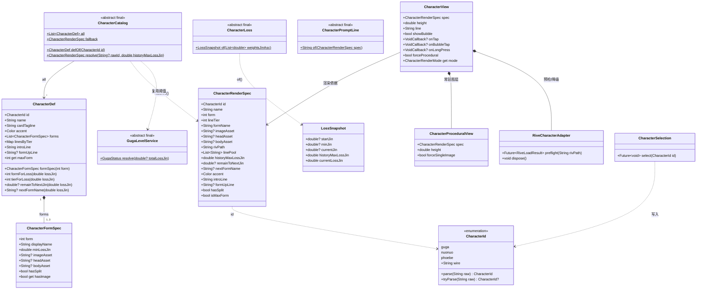
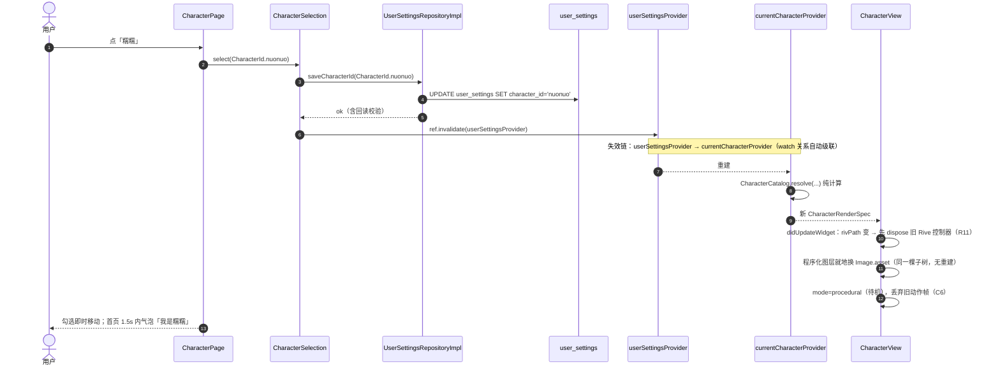
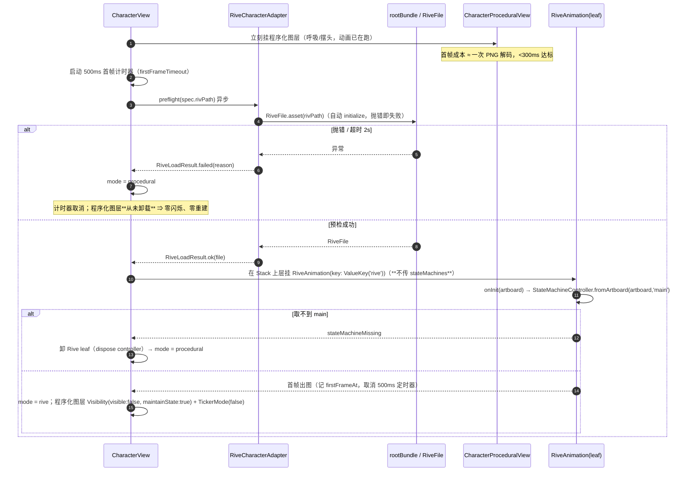
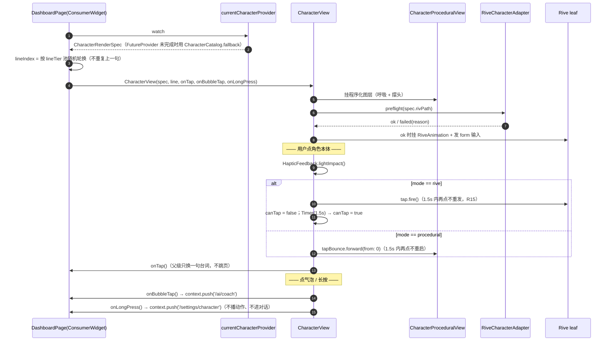
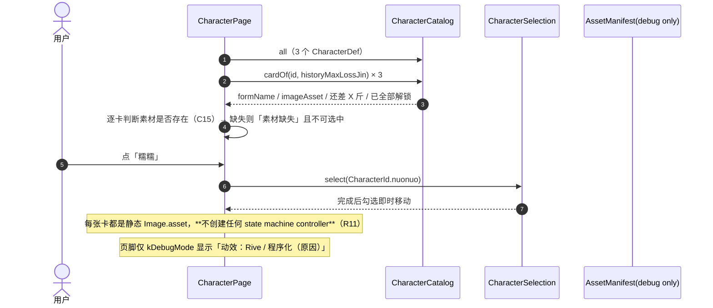
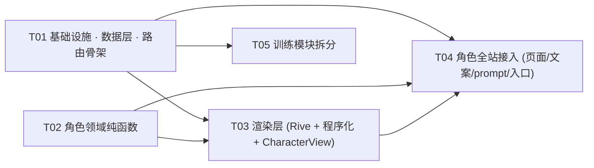

# 三角色形象系统 + 训练模块拆分 + Rive 动效 —— 系统设计（P0）

> 输入：`docs/spec/CHARACTERS-P0.md`（唯一需求源）、`PROJECT.md`、`DEVELOPMENT_PLAYBOOK.md`、当前 `lib/` 实况（已逐文件核对）
> 作者：高见远（架构师）｜本文只做设计，不含 `lib/` 代码、不跑 `flutter`、不 commit
> 结论先行，细节在后。凡是与 PRD 原文不一致的地方，都在 §9 列了「我改了什么 + 证据」。

---

## 0. 一页结论

### 0.1 五个关键设计决定

| # | 决定 | 一句话理由 |
|---|---|---|
| D-a | **角色/形态的一切渲染描述由一个纯函数产出**：`CharacterCatalog.resolve(rawId, historyMaxLossJin) → CharacterRenderSpec` | C12 要求「纯函数、可单测、不读 DB」。全 App 4 处渲染（首页角色、问候头像、趋势卡、聊天头像）只准读这一个规格，杜绝第二套口径 |
| D-b | **资产路径由注册表声明，不由代码拼字符串** | PRD R2 写的是 `assets/characters/{c}_{f}.png`，但咕嘎的真实文件在 `assets/guga3d/guga_{fat,normal,small}.png`（还有 `_head/_body` 拆分）。硬拼路径会让咕嘎的问候头像变白框。见 §9-修正 2 |
| D-c | **Rive 只锁 `rive: 0.13.20`（精确版本，不带 `^`）** | 0.14.x 起改用 `rive_native`（FFI + native assets hook，要从 GitHub 下载预编译库）—— 本机网络已因此被迫给 sqlite3 打补丁（`pubspec.yaml` 的 `hooks.user_defines`）。为一个 195px 的角色区再引一条网络依赖不值。见 §4.1 |
| D-d | **降级是默认路径，不是异常路径** | 本期 10 个 `.riv` 一个都不存在 ⇒ 上线后 100% 走程序化动画。Rive 只在"预检通过"后才挂载，且**程序化图层永不卸载**（`Visibility(maintainState)` + `TickerMode`），降级时不重建任何子树 ⇒ 不闪 |
| D-e | **`app_router.dart` 由 T01 一次性改完（含两条新路由 + 一个 redirect），T03/T04/T05 谁都不再碰它** | 唯一的跨任务热点文件。T01 同时落地两个「骨架页」，保证 T01 结束时编译绿、路由可达，后续任务各自在自己那份文件里填肉 |

### 0.2 交付物与规模

- 新增 **17** 个 `lib/` 文件、**19** 个测试文件、**1** 个资产说明文件（`assets/rive/PROVENANCE.md`）
- 修改 **15** 个既有文件、删除 **3** 个（`history_segment.dart`、`workout_list_page.dart`、`guga_puppet.dart`）
- 新依赖：**只有 `rive: 0.13.20`**
- 迁移：schema **v24 → v25**，`user_settings` 加 **1 列**，不建表
- 任务：**5 个（T01–T05）**，并行波次 `{T01,T02} → {T03,T05} → {T04}`

### 0.3 一句话验收观感

换形象 3 次点击、即时生效、无重启提示；删掉 `assets/rive/guga_1.riv` 后角色照样呼吸照样回应、零提示；训练 Tab 打开就能开练，记录搬到 `/workout/records` 且全库只剩一份列表。

---

## 1. 领域模型与资产注册表

### 1.1 类图



### 1.2 资产注册表（唯一事实来源）

**代码里只允许读这张表**（`character_catalog.dart` 的 `const` 列表），任何 `.replaceFirst('.png', '_head.png')` 这类拼接都算违规。

| 角色 | form | 立绘（`imageAsset`） | 分层（`headAsset` / `bodyAsset`） | `.riv`（`rivPath`） | 主色 |
|---|---|---|---|---|---|
| guga 咕嘎 | 1 | `assets/guga3d/guga_fat.png` | `guga_fat_head.png` / `guga_fat_body.png` | `assets/rive/guga_1.riv` | `AppColors.primary` |
| guga 咕嘎 | 2 | `assets/guga3d/guga_normal.png` | `guga_normal_head.png` / `guga_normal_body.png` | `assets/rive/guga_2.riv` | 同上 |
| guga 咕嘎 | 3 | `assets/guga3d/guga_small.png` | `guga_small_head.png` / `guga_small_body.png` | `assets/rive/guga_3.riv` | 同上 |
| nuonuo 糯糯 | 1 | `assets/characters/nuonuo_1.png` | — | `assets/rive/nuonuo_1.riv` | `AppColors.info` |
| nuonuo 糯糯 | 2 | `assets/characters/nuonuo_2.png` | — | `assets/rive/nuonuo_2.riv` | 同上 |
| nuonuo 糯糯 | 3 | `assets/characters/nuonuo_3.png` | — | `assets/rive/nuonuo_3.riv` | 同上 |
| phoebe 菲比 | 1 | `assets/characters/phoebe_1.png` | — | `assets/rive/phoebe_1.riv` | `AppColors.analysis` |

**菲比映射三阶段的规则**：`forms.length == 1`，`form` 恒 = 1，`formName` 恒 = `菲比`；但 `lineTier` 仍按 0/2/5 斤算 1/2/3（C11）。`lineTier` 对三角色是**同一套机制**，不是菲比特例。

> 主色只取 `AppColors` 现有令牌（该文件自称"全站唯一色彩来源"），不新增色值 —— 避免和主题打架。

### 1.3 文案常量（`character_lines.dart`）

| 常量 | 内容 | 依据 |
|---|---|---|
| `kForbiddenFormWords` | `['瘦了','变瘦','苗条','胖了','减肥形态','瘦身版']` | C10（**不含"肥"**，咕嘎档名沿用） |
| `kCharacterSlogan`（形象页页头） | 换一个你愿意天天看见的。样子会跟着你减了多少变，但不会因为今天涨了一斤就退回去。 | 6.3 |
| `kMissingAssetPlaceholder` | 素材缺失（这个形象加载不出来，先用咕嘎） | 6.3 |
| `linesByTier` / `introLine` / `formUpLine` | 按 PRD 6.3 逐句抄，不做改写 | 6.3 |

### 1.4 "只升不降"的取数口径与边界

```dart
// lib/core/services/character_loss.dart
class LossSnapshot {
  final double? startJin;            // 最早一条（按 date 升序的第一条）
  final double? minJin;              // 全历史最低
  final double? currentJin;          // 最新一条
  final double historyMaxLossJin;    // 形态口径 = start - min（clamp ≥ 0）
  final double currentLossJin;       // 展示口径 = start - current（可为负）
}

abstract final class CharacterLoss {
  /// 入参必须按 date **升序**（`BodyMetricRepository.getAll()` 天然升序）。
  /// 本函数不排序：排序口径只允许有一处，放在仓储里。
  static LossSnapshot of(List<double> weightsJinAsc);
}
```

| 场景 | 结果 | 处理 |
|---|---|---|
| 0 条记录 | `start=min=current=null`，两个 loss 都 = 0 | form 1；**不显示**「再减 NaN 斤」 |
| 只有 1 条 | `start == min == current`，两个 loss = 0 | form 1 |
| 体重涨了（减重为负） | `historyMaxLossJin = 0`（clamp） | form 1；文案不出现负数与「胖」 |
| 60 → 58 → 59 → 58.5 | `start=60, min=58` ⇒ 历史最大减重 2.0 | **form 2**，再录 59 仍是 form 2（C7） |
| 只有 1 条但恰好 = 5 斤差 | 不可能（单条 start==min） | — |
| 删掉最低点那条记录 | `min` 重算 ⇒ form 可能回退 | **允许**（自愈，不做补偿，C7/§8） |
| 删掉最早那条记录 | `start` 后移 ⇒ loss 可能变大或变小 | 允许（同上） |

> **"只升不降"不是"存一个永不下降的值"，而是"口径换成历史最低点"。** 因此它零新增字段、零新增一致性风险，且删记录后能自愈 —— 这与 COACH-PRD 决策 5「重复存储必然和真数据打架」同源。
> **与 `GugaLevelService` 的关系**：`character_catalog` 内部**复用** `GugaLevelService.resolve()` 取 `level`（1/2/3）与 `remainToNext`，不重写 0/2/5 阈值，保留其名字、文件、既有测试（见 §9-修正 3）。

---

## 2. 数据与迁移

### 2.1 唯一新增列

| 表 | 列 | drift 定义 | SQL（迁移时由 drift 生成） |
|---|---|---|---|
| `user_settings` | `character_id` | `TextColumn get characterId => text().withDefault(const Constant('guga'))();` | `ALTER TABLE user_settings ADD COLUMN character_id TEXT NOT NULL DEFAULT 'guga'` |

迁移块（v24 → v25），**必须用幂等助手**：

```dart
if (from < 25) {
  step = 'addColumn:character_id';
  if (await _tableExists(this, 'user_settings')) {          // 半迁移现场兜底，与 v24 块同款
    await addColumnIfNotExists(m, userSettings, userSettings.characterId);
  }
}
```

> ⚠️ **`addColumnIfNotExists(m, table, column)` 没有 `defaultValue` 参数**（已核对 `migration_helpers.dart:88`）。默认值必须写在**列定义**的 `withDefault()` 上 —— PRD 7.1 写的 `defaultValue:` 写法在本仓库不存在，见 §9-修正 1。
> `NOT NULL` 必须有默认值，否则老库（有行）升级时 SQLite 直接抛错。同款注释先例见 `database.dart:174-176`。

### 2.2 三条默认路径（C3）

| 路径 | 结果 | 机制 |
|---|---|---|
| 空库安装 | `guga` | `onCreate` → `createAll()` 用列默认值 |
| v24 老库升级 | `guga` | `ALTER TABLE ... DEFAULT 'guga'` 回填所有既有行 |
| `wipe_all_data` 后 | `guga` | `user_settings` 已在 `DataWipeService.tableNames`，删行后下次 `save()` 重建行 → 默认值 |
| 还没建过设置行（新用户没填过任何东西） | `guga` | `userSettingsProvider` 返回 `null` → `rawId = null` → 按 guga 渲染 |

### 2.3 非法值不回写（C4）

```dart
// 读：single source
static CharacterId parse(String? raw) => tryParse(raw) ?? CharacterId.guga;
// 写：唯一的写入口，且**只接受 CharacterId 枚举**
Future<void> saveCharacterId(CharacterId id);   // 仓储接口签名收窄成枚举
```

仓储层的写方法**签名是枚举**，不是 `String` —— 这样"把 DB 里的脏值原样写回去"在类型层面就不成立。读路径永不写库。C-4 的测试（塞 `'nuonuo_v2'` → 读一次 → 库里仍是 `'nuonuo_v2'`）天然通过。

### 2.4 兼容半径

| 项 | 结论 |
|---|---|
| 备份/恢复 | 整库快照，`character_id` 天然在内；**CSV 导出不含它**（偏好不是身体数据） |
| v25 备份恢复到 v24 App | 报「这份备份来自更新版本…请先更新 App」（`restore_service.dart:383` 既有行为），符合预期 |
| 老版本降级 | 旧 App 不认识 `character_id` 列，drift 会忽略未知列 ⇒ 显示咕嘎，**数据不丢** |
| 不新建表 / 不新建索引 / 不写种子 DML / 不用事务 | 纯加列（playbook 7.4） |

### 2.5 切换的即时生效链（C5 / C6）



- **不重启、不二次确认、不提示「重启生效」**。
- **哪些东西会丢**：正在播的 `tap_react` / `celebrate`、旧 `.riv` 的 controller。三者随 `mode` 回落 procedural 一起丢弃，不跨角色续播。
- **台词「我是○○」的 1.5s 窗口**由首页持有（`_introUntil = now + 1.5s`），不放进 `CharacterView` —— 组件只管"显示传入的这一句"。

---

## 3. Rive 接入

### 3.1 依赖与 pubspec 写法

```yaml
dependencies:
  # 精确版本，不用 ^：0.14.x 改用 rive_native（native assets hook 从 GitHub 拉预编译库），
  # 本机网络已因此给 sqlite3 打过补丁（见本文件 hooks 段），不再引第二条网络依赖。
  rive: 0.13.20

flutter:
  assets:
    - assets/            # 既有
    - assets/characters/ # 新增（目录，不逐个文件，R3）
    - assets/rive/       # 新增（目录！空目录会让构建报 unable to find directory entry）
```

| 版本 | 结论 |
|---|---|
| `0.13.20` | ✅ **选用**。Dart ≥2.17 下限，不挑 SDK；`rive_common` 走插件自带构建，无 native-asset 下载钩子；`RiveAnimation` / `StateMachineController` / `SMITrigger|SMIBool|SMINumber` 都在 |
| `0.14.11`（latest） | ❌ 引入 `rive_native`（FFI，C++ core runtime），native assets hook 需从 GitHub 取预编译库；本机已因同类问题给 sqlite3 写过 `user_defines` 例外 |
| `0.15.0-dev.*` | ❌ 预发布，API 仍在变（view model 绑定刚重做） |

> ⚠️ **任务书里写的 `RiveAnimationController` 在 0.13.x 已不是推荐入口**：点击态一律用 `StateMachineController` + `SMITrigger.fire()`。`RiveAnimationController` 只用于"播一条线性动画"，本期用不到。见 §9-修正 4。

### 3.2 状态机契约（给 Rive 作者，直接在编辑器里照此实现）

**state machine 名固定 `main`**（R5）。

输入（Flutter → Rive）

| 名 | 类型 | 值域 | 何时发 | 缺失时 |
|---|---|---|---|---|
| `tap` | Trigger | — | 点角色本体，**每次点击只 fire 一次** | 忽略，不降级（R5/R7） |
| `speaking` | Boolean | true/false | 台词气泡出现/消失 | 忽略（R16） |
| `form` | Number | **1 / 2 / 3** | 进入角色区首帧 + 形态变化后 | 忽略 |
| `celebrate` | Trigger | — | `form` 变大那一帧，只发一次 | 忽略（R17） |

输出（Rive → Flutter）

| 名 | 类型 | 用途 | 缺失时 |
|---|---|---|---|
| `react_end` | Rive event | 点击动作播完 | Flutter 侧 **1.5s 超时**兜底恢复可点（R7） |

内部状态：`idle`（默认，循环，**必须能无限播**）/ `tap_react`（≤1.5s）/ `celebrate`（≤2.0s）。`speaking` 只用布尔驱动混合，**不许**做成会打断 `tap_react` 的状态。

### 3.3 播放器接口

```dart
// lib/features/dashboard/presentation/widgets/character_view.dart
enum CharacterRenderMode { rive, procedural }

class CharacterView extends StatefulWidget {
  const CharacterView({
    super.key,
    required this.spec,              // CharacterRenderSpec（唯一渲染依据）
    this.height = 195,
    this.line,                       // 当前台词；空/ null → 不画气泡
    this.isChatEntry = true,         // 气泡带主题色描边 + 聊天图标
    this.onTap,                      // 播动作 + 父级换台词（不跳页，R14）
    this.onBubbleTap,                // 进 /ai/coach
    this.onLongPress,                // 进 /settings/character（R17/C17）
    this.forceProcedural = false,    // 测试用：强制降级（默认 false）
    this.onModeResolved,             // debug 小字用：把 mode+原因回抛
  });

  /// 当前实际渲染模式（debug/测试读）
  CharacterRenderMode get mode;
}
```

降级原因枚举（只进 debug 小字与 `debugPrint`，**不弹窗不写库**，C15/R8）：

```dart
enum RiveFallbackReason {
  none,               // Rive 正常
  fileMissing,        // rootBundle.load / RiveFile.asset 抛错 → 文件不在
  parseFailed,        // 解析异常（RiveException）
  versionUnsupported, // 数据版本高于运行时
  firstFrameTimeout,  // 500ms 未出首帧
  stateMachineMissing,// 找不到 main
}
```

### 3.4 挂载/降级时序（**这是本期最容易写出闪烁的一段**）



**"不重建整个 widget 树"的具体做法**（4 条硬约束）：

1. 外层 `SizedBox(width: h*0.82, height: h)` 尺寸只由 `height` 决定，**与渲染模式无关** ⇒ 切换不发生 relayout，不会跳。
2. 程序化图层 `Visibility(visible: mode==procedural, maintainState: true, maintainSize: true, maintainAnimation: true)` —— 只隐藏不卸载，状态与帧连续。
3. 隐藏时用 `TickerMode(enabled: false)` 把 `AnimationController` 停掉（不 dispose），CPU 归零。
4. Rive 图层用固定的 `ValueKey('rive')`，只在 `mode` 变化时挂/卸；`spec` 变化时先 `dispose` 旧 controller 再预检（R11：同屏 ≤1 controller）。

### 3.5 `RiveCharacterAdapter`（**唯一允许 `import 'package:rive/rive.dart'` 的文件**）

```dart
// lib/features/dashboard/presentation/widgets/character_rive_adapter.dart
class RiveLoadResult {
  final bool ok;
  final RiveFallbackReason reason;
  const RiveLoadResult.ok() : ok = true, reason = RiveFallbackReason.none;
  const RiveLoadResult.failed(this.reason) : ok = false;
}

class RiveCharacterAdapter {
  /// 预检：只做"文件在 / 能解析 / 版本兼容"三件事，不建控制器。
  /// 挂上 2s 超时 —— 预检慢说明这设备播不动，直接降级比卡住好。
  Future<RiveLoadResult> preflight(String rivPath);

  /// 全局控制器计数：只允许 0 或 1（R11 的可测形式）
  static int get liveControllerCount;

  void dispose();
}
```

`onInit` 里集中做输入解析，**每个输入单独 try/忽略**：

```dart
// 伪代码，落在 character_rive_adapter.dart 内部
void _onRiveInit(Artboard artboard) {
  // ⚠️ 不要给 RiveAnimation 传 stateMachines: ['main']：
  //    那个参数会让它自己再造一个 controller，我们这里再 fromArtboard 一遍
  //    ⇒ 同一个 state machine 挂 2 个 controller，直接违反 R11（同屏 ≤1）。
  //    只在这里自建 + addController 一次。
  final sm = StateMachineController.fromArtboard(artboard, 'main');
  if (sm == null) { _degrade(RiveFallbackReason.stateMachineMissing); return; }
  artboard.addController(sm);
  _tap      = sm.findInput<SMITrigger>('tap');      // null 就 null，不降级
  _speaking = sm.findInput<SMIBool>('speaking');
  _form     = sm.findInput<SMINumber>('form');
  _celebrate= sm.findInput<SMITrigger>('celebrate');
  _publishFirstFrame();
}
```

### 3.6 性能预算与**验证方法**（R12/R13 的可执行版本）

| 指标 | 红线 | 怎么量（写进 PR 描述） |
|---|---|---|
| 单个 `.riv` | ≤300 KB | `ls -l assets/rive/*.riv` |
| 同屏 controller | ≤1 | `RiveCharacterAdapter.liveControllerCount`（测试断言，见 §7 T03） |
| 角色区首帧 | ≤300 ms（p50，中端机） | `CharacterView` 在 `firstFrameAt` 里 `debugPrint` 相对 `initState` 的耗时；`flutter run --profile` 采 10 次取中位 |
| 待机帧率 | ≥50 fps，p95 ≤20 ms | `flutter run --profile` → DevTools Performance → 录首页 10s → 看 Raster/UI 帧时间 |
| 内存增量 | ≤30 MB | DevTools Memory → 进入首页前后各 snapshot → 比 `Graphics` + `Dart` 增量 |
| 冷启动到可交互 | ≤1.5 s，不得比基线差 | `flutter run --profile` 首帧时间戳（既有基线） |
| PNG 长边/体积 | ≤1200 px / ≤400 KB / 单角色 ≤1.2 MB | **自动**：`test/asset_guard_test.dart` 读 PNG 头解析宽高（`dart:ui` 解码），不靠人眼 |
| APK 增量 | ≤3 MB | `flutter build apk --release` 前后 `ls -l`，并 `unzip -l … | grep -E 'characters|rive'` 核对 |

> R12 的"人工"部分（帧率/内存）只在 PR 描述里附图，不进 CI —— CI 上跑性能数字不可信（CI 机器与真机差异 >2×），所以 CI 只守"体积/数量/文件存在"这些硬指标。

### 3.7 资源占位与"死资源"纪律

- `assets/rive/` 本轮**只放一个 `PROVENANCE.md`**（说明命名规则 `{character}_{form}.riv`、来源、如何替换、为什么现在没有）。
  - 目录非空 ⇒ 满足 R3 的构建要求；1KB 文本 ⇒ 不构成包体负担。
- **不塞任何真实 `.riv`**：本期 10 个 `.riv` 全缺 ⇒ 上线后 100% 走降级，正好把降级路径变成默认路径。
- 若工程/验收需要一个"Rive 成功链路"的回归夹具：允许放 `assets/rive/placeholder.riv`（官方 example，≤50 KB），**但**必须满足三条：① 文件路径不出现在任何 `CharacterFormSpec` 的 `rivPath`（只能被测试引用）；② `PROVENANCE.md` 写清来源与替换方式；③ 任何时刻删掉它不影响 App 行为。

---

## 4. 训练模块拆分

### 4.1 训练 Tab 新组件树（T1–T5）

```
/workout  →  QuickStartPage（沿用类名，原地改造，删除「历史」段）
Scaffold
├─ AppBar(title: '训练')
│   actions: [ IconButton(Icons.history, tooltip:'训练记录') → push /workout/records,
│              IconButton(Icons.add,     tooltip:'新建模板') → push /workout/template-edit ]
├─ Column
│   ├─ SegmentedButton<int>  ← 只有 2 段：计划(0) | 模板(1)，默认选中模板
│   └─ Expanded → switch(_segment) { 0 => PlanSegment(), _ => 模板区 }
│
└─ （无 FAB，T4）
模板区 = TemplateFilterBar + MyTemplatesSection + RecommendedSection  ← 三个组件原样复用，不重画
```

- `_segment` 默认值从 `1`（模板）改成 `1`（仍是模板，但枚举只剩 0/1）；`HistorySegment` 的 import 与 `2 =>` 分支一起删除。
- **不引入时长选择器**（T5）：不出现 10/5/23 分钟常量与控件。

### 4.2 训练记录页组件树（T6–T12）

```
/workout/records  →  WorkoutRecordsPage（新建，来自 workout_list_page.dart 的改造）
Scaffold(AppBar(title:'训练记录'))
├─ actions: [ IconButton(Icons.calendar_month, tooltip:'训练计划') → /plan,
│             IconButton(Icons.bar_chart,      tooltip:'训练统计') → /workout/stats ]
└─ Column
    ├─ WorkoutWeekStrip        ← 周日期条（周一为起点、橙=训练/蓝=称重双点、左右翻周）
    │    （图例「训练/称重」两枚圆点**移进这个组件内部**，让页面只剩 3 个块，T7 断言干净）
    ├─ WorkoutWeekSummary      ← 新增：本周 N 次 / 共 M 分钟 / 连续 W 周 + 「看统计」
    └─ Expanded
        ├─ 有记录 → ListView(WorkoutRecordCard × n)
        └─ 无记录 → 空态（两种文案，T16/T17）
```

**复用 vs 抽取的结论（不允许两套列表逻辑）**

| 现文件（行数） | 处置 | 新落点 |
|---|---|---|
| `workout_list_page.dart`（485） | **搬家 + 拆分 + 删除原文件** | `workout_records_page.dart`（页面壳，≤300） |
| 其中 `_WeekStrip` + `_DayCell` | 提成公开 widget | `widgets/workout_week_strip.dart`（≤200） |
| 其中 `_WorkoutCard` | 提成公开 widget | `widgets/workout_record_card.dart`（≤110） |
| 其中 `_EmptyState` | 挪进页面（两态合一，参数化文案） | `workout_records_page.dart` 内私有 |
| （无） | 新建 | `widgets/workout_week_summary.dart`（≤150） |
| `history_segment.dart`（96） | **整文件删除**（T13） | — |

> 只"搬家 + 提公开"，**不重写**已有的跨月翻周、同日多条排序、双色点逻辑 —— 这些是踩过坑的边界代码，重写等于重新踩一遍（PRD 决策 10 的反面论证）。

### 4.3 本周摘要的纯函数（T11 口径，含"本周为空"）

```dart
// lib/features/workout/domain/week_summary.dart
class WeekSummary {
  final int weekCount;        // 本周训练次数
  final int weekMinutes;      // 本周总时长（四舍五入到分钟，null 时长不计入）
  final int streakWeeks;      // 连续有训练的周数（允许本周为空）
}

abstract final class WeekSummaryCalc {
  /// 周一 00:00 为一周起点；[now] 只用于确定"本周"，便于单测注入。
  static WeekSummary of(List<DateTime> workoutDates, {required DateTime now});
}
```

`streakWeeks` 算法（**按 PRD 原样，不改**）：
1. 取 `weekOf(d)` = 该日期所在周的周一（`d - (weekday-1)` 天，取 `DateTime(y,m,d)` 归一化）；
2. 把训练日期映射成周一集合 `Set<DateTime>`；
3. `cursor = weekOf(now)`；**若 `cursor` 不在集合里 → 先 `cursor -= 7d` 一次**（本周还没练：不计数、不中断）；
4. 之后 `while (set.contains(cursor)) { streak++; cursor -= 7d; }`。

→ 连续 3 周有训练、本周 0 次：`streakWeeks = 3`（不是 0）；中间断一周：从断点重算。

### 4.4 路由表变更（T18 + 新页）

| 路由 | 变更 | 备注 |
|---|---|---|
| `/workout` | 组件改成 `QuickStartPage`（改造后） | Tab，仍走 `_tabPage` |
| `/workout/records` | **新增** → `WorkoutRecordsPage` | 二级页，`_subPageTransition` |
| `/workout/quick-start` | **改成 redirect → `/workout`** | 老深链不白屏（与 `/settings/body-info`、`/goals` 同惯例） |
| `/settings/character` | **新增** → `CharacterPage` | 二级页 |
| `/workout/stats` | 不变 | |
| `/workout/:id` | 不变 | |

> ⚠️ **`/workout/records` 必须声明在 `/workout/:id` 之前**。go_router 按声明顺序匹配：现有 `/workout/stats`、`/workout/active`、`/workout/template-edit` 都排在 `:id` 前面，新路由照此位置插入；顺序写反 ⇒ 点「训练记录」进「无效的训练ID」。这是本期最容易漏的一个 bug。

### 4.5 双入口（T3 / T14）

| 入口 | 位置 | 跳转 |
|---|---|---|
| ① | 训练页 AppBar 第一个 action（`Icons.history`，tooltip「训练记录」） | `push /workout/records` |
| ② | 我的 → 我的档案 → 第 4 个 tile（`Icons.event_note`，subtitle「练了几次、哪些天练的」） | `push /workout/records` |

> tile 顺序：个人档案 / 动作库 / 身体相册 / **我的形象** / **训练记录** —— 两个 tile 都归 T04 落的 `settings_page.dart`（T05 不碰该文件，见 §7 冲突矩阵）。

### 4.6 「再练一次」（T15）

```dart
// lib/features/workout/domain/workout_repeat.dart
abstract final class WorkoutRepeat {
  /// 由一条历史记录生成待开练的 slots。
  /// 按 exerciseId 分组、组数取该动作出现过的组数、次数/时长取该动作的众数（并列取较大值）。
  /// ⚠️ **绝不赋值 targetWeightKg**（T15：预填重量 = 受伤 + 数据造假两个坑的共同源头）。
  static List<ExerciseSlot> slotsOf(
    WorkoutEntity workout,
    Map<int, String> exerciseNames,
    Map<int, String> exerciseCategories,
  );
}
```

- 落点：详情页 `ListView` 末尾一个全宽 `OutlinedButton.icon(Icons.replay, '再练一次')` → `pushReplacement('/workout/active', extra: slots)`。
  - **用 `pushReplacement`**：练完返回应回记录页，不该回详情页。
  - `sets.isEmpty` ⇒ `onPressed: null` + tooltip「这条记录没有动作明细」。
- 卡片上**不放**按钮（整卡已是点击热区，PRD 决策 11）。
- 为守住行数：按钮单独成 `widgets/workout_repeat_button.dart`（≤60 行），详情页只加 3 行。

---

## 5. 程序调用流程（关键操作）

### 5.1 首页角色区：首帧 + 台词 + 点击语义（R14/R15/R16）



### 5.2 形象页：3 张卡 + 选中（C18，**0 个 Rive controller**）



素材存在性判定（C15/C16）用 `AssetManifest` 一次性取清单，**不要**逐卡 `rootBundle.load` 再 catch（那会真的解码 7 张图）：

```dart
// 只查清单，不解码；缺失 → 该卡显示「素材缺失」，且若是当前项则首页回落咕嘎同形态
Future<Set<String>> CharacterAssets.declared(); // AssetManifest.loadFromAssetBundle(rootBundle).listAssets()
```

---

## 6. 任务拆解（5 个，硬上限内）

### 6.1 依赖总览



**并行分组（谁的完成不阻塞谁）**

| 波次 | 可并行任务 | 前提 |
|---|---|---|
| W1 | **T01 ∥ T02** | 两者零共同文件；T02 是纯函数，不 import 任何实体 |
| W2 | **T03 ∥ T05** | 两者零共同文件；都不碰 `app_router.dart` / `settings_page.dart` |
| W3 | **T04** | 需要 T02 的 `resolve()` API 与 T03 的 `CharacterView` API 就位 |

### 6.2 任务明细

#### T01 · 基础设施 + 数据层 + 路由骨架
- **目标**：依赖落地、资产目录可构建、`character_id` 列与迁移可跑、两条新路由可达（指向最小骨架页，保证本任务结束时 `check.sh` 绿）
- **文件（新增 3 / 修改 6 / 测试 2）**
  - `pubspec.yaml`（+`rive: 0.13.20`；`assets/characters/`、`assets/rive/` 目录声明）
  - `assets/rive/PROVENANCE.md`（新增，说明命名/来源/替换方式/为何暂时为空）
  - `lib/core/database/database.dart`（`kSchemaVersion` 24→25、`characterId` 列、v25 迁移块）
  - `lib/features/settings/domain/entities/user_settings_entity.dart`（+`characterId`）
  - `lib/features/settings/domain/repositories/user_settings_repository.dart`（+`saveCharacterId(CharacterId)`）
  - `lib/features/settings/data/user_settings_repository_impl.dart`（实现 + `_toEntity` 映射）
  - `lib/core/router/app_router.dart`（`/workout/records`、`/settings/character`、`/workout/quick-start` redirect）⚠️ **全部路由改动在此一次做完**
  - `lib/features/settings/presentation/pages/character_page.dart`（**骨架**：Scaffold + 标题「我的形象」+ 空态）
  - `lib/features/workout/presentation/pages/workout_records_page.dart`（**骨架**：Scaffold + 标题「训练记录」）
  - `test/migration_v25_test.dart`（v24 假库 → v25：列存在、默认 `'guga'`、表数量不变）
  - `test/character_id_storage_test.dart`（C-3 三条路径 + C-4 不回写）
- **依赖**：无
- **验收映射**：C2 / C3 / C4 → C-2 / C-3 / C-4；R1 / R3 → R-1 / R-3；T3·T6·T18 的路由部分

#### T02 · 角色领域纯函数（零 UI、零 DB）
- **目标**：把"角色 + 减重 → 完整渲染描述"做成可单测的纯函数；台词/形态名/禁用词全部集中
- **文件（新增 4 / 测试 4）**
  - `lib/core/services/character_catalog.dart`（`CharacterId` / `CharacterFormSpec` / `CharacterDef` / `CharacterRenderSpec` / `CharacterCatalog`）
  - `lib/core/services/character_lines.dart`（台词池 ×9 档、介绍名、切换/升级文案、`kForbiddenFormWords`）
  - `lib/core/services/character_loss.dart`（`CharacterLoss.of` → `LossSnapshot`）
  - `lib/core/services/character_prompt_line.dart`（`CharacterPromptLine.of(spec)`，C14 一行）
  - `test/character_catalog_test.dart`（C-1 / C-9 / C-11 / C-12）
  - `test/character_loss_test.dart`（C-7 的 60→58→59→58.5 + 0 条/1 条/涨了）
  - `test/character_fallback_test.dart`（素材缺失 → 咕嘎同形态；C-15 的纯函数部分）
  - `test/no_forbidden_words_test.dart`（C-10，扫 `lib/` 下字符串常量）
- **依赖**：无（不 import 任何 feature 实体 —— 只吃 `List<double>`）
- **验收映射**：C1 / C7 / C8 / C9 / C10 / C11 / C12 / C14 → C-1 / C-7 / C-8 / C-9 / C-10 / C-11 / C-12 / C-14

#### T03 · 渲染层：Rive 接入 + 程序化降级 + CharacterView
- **目标**：一个组件同时支持 Rive 与程序化两条路径，行为等价、降级不闪、同屏 ≤1 controller
- **文件（新增 4 / 测试 3）**
  - `lib/features/dashboard/presentation/widgets/character_view.dart`（`CharacterView`，含手势三分离 + 气泡 + 台词 + speaking/form/celebrate 输入 + 首帧超时）
  - `lib/features/dashboard/presentation/widgets/character_rive_adapter.dart`（**唯一** `import 'package:rive'`；`preflight` + `RiveAnimation` + `StateMachineController` + controller 计数）
  - `lib/features/dashboard/presentation/widgets/character_procedural.dart`（单图呼吸 / 分层呼吸 + 点击摆头弹跳；吸收现 `GugaPuppet` 与 `GugaStand` 的行为，**只此一份**）
  - `lib/core/services/character_providers.dart`（`bodyWeightsJinProvider` / `currentCharacterProvider` / `CharacterSelection`）
  - `test/character_view_test.dart`（R-10 参数化：rive 假实现 / 程序化，跑同一组交互断言）
  - `test/character_rive_fallback_test.dart`（R-4 / R-8 四例 + R-5 两例 + R-7 / R-15 / R-16 / R-17）
  - `test/character_controller_budget_test.dart`（R-11：进出 10 次计数回 0）
- **依赖**：T01（pubspec 的 rive）、T02（catalog API）
- **验收映射**：R1/R2/R4–R11/R14–R17、C5/C6 的组件侧
- **注意**：本任务**不改** `dashboard_page.dart`，`CharacterView` 由测试直接实例化 ⇒ 与 T04/T05 零文件冲突

#### T04 · 角色全站接入（页面 / 文案 / prompt / 入口）
- **目标**：让"当前角色"在 4 个渲染位 + 1 处 prompt + 2 个入口全部生效；删掉用户可见的「咕嘎」字面量
- **文件（修改 8 / 新增 1 / 删除 1 / 测试 4）**
  - `lib/features/dashboard/presentation/pages/dashboard_page.dart`（`GugaPuppet` → `CharacterView`；长按入口；问候传**角色名**不传形态名）
  - `lib/features/settings/presentation/pages/character_page.dart`（骨架 → 完整：3 卡 + 勾选 + 还差 X 斤/已解锁 + debug 渲染模式行）
  - `lib/features/dashboard/presentation/widgets/greeting_header.dart`（`gugaName` → `characterName`，语义改为「角色名，不带形态名」）
  - `lib/features/dashboard/presentation/widgets/today_tasks_card.dart`（`gugaAsset` → `characterAsset` + `characterName`；「咕嘎为你鼓掌」→ 动态）
  - `lib/features/trends/presentation/widgets/companion_card.dart`（「我的咕嘎」→「我的{角色名}」；解锁提示改口「换下一个样子」；头像走 catalog，**含当前角色的 `_head` 与否由注册表决定**）
  - `lib/features/ai/presentation/pages/ai_chat_page.dart`（头像走 catalog，删掉 `.replaceFirst('.png','_head.png')`）
  - `lib/core/services/ai_prompt_builder.dart`（+1 行调用 `CharacterPromptLine.of(spec)`；见下方行数条款）
  - `lib/features/settings/presentation/pages/settings_page.dart`（+「我的形象」+「训练记录」两个 tile）
  - `lib/features/dashboard/presentation/widgets/guga_puppet.dart`（**删除**：行为已演化为 `character_procedural.dart`，不许留第二份呼吸动画）
  - `test/character_switch_test.dart`（C-5 / C-6 / C-17）
  - `test/character_texts_test.dart`（C-19 / C-20 / C-18）
  - `test/character_prompt_test.dart`（C-13 教练内核未变 + C-14）
  - `test/character_page_missing_asset_test.dart`（C-15 的 UI 部分）
- **`ai_prompt_builder.dart` 行数条款（硬）**：它现在 **308 行**，已超 300 纪律。本期**不允许净增行数**：把"角色名那一行"改成调用 `CharacterPromptLine.of(...)` 后，必须顺手把 `_examples`（17 行）搬到 `lib/core/services/ai_prompt_constants.dart`，使 308 → **≤295**。搬家时**一个字符都不许改**（C-13 基线测试会逐字比对）——搬常量不搬逻辑。
- **依赖**：T02、T03
- **验收映射**：C5/C6/C13/C15/C17/C18/C19/C20 → C-5/C-6/C-13/C-15/C-17/C-18/C-19/C-20；T14、T-14

#### T05 · 训练模块拆分
- **目标**：训练 Tab 只回答"现在练什么"；记录页独立且全库只有一份列表
- **文件（新增 6 / 修改 3 / 删除 2 / 测试 6）**
  - `lib/features/workout/presentation/pages/workout_records_page.dart`（骨架 → 完整三块）
  - `lib/features/workout/presentation/widgets/workout_week_strip.dart`
  - `lib/features/workout/presentation/widgets/workout_record_card.dart`
  - `lib/features/workout/presentation/widgets/workout_week_summary.dart`
  - `lib/features/workout/presentation/widgets/workout_repeat_button.dart`
  - `lib/features/workout/domain/week_summary.dart`
  - `lib/features/workout/domain/workout_repeat.dart`
  - `lib/features/workout/presentation/pages/quick_start_page.dart`（3 段 → 2 段；AppBar 两个 action；删 FAB；删 `HistorySegment` import）
  - `lib/features/workout/presentation/pages/workout_detail_page.dart`（末尾挂 `WorkoutRepeatButton`）
  - `lib/features/workout/presentation/widgets/history_segment.dart`（**删除**）
  - `lib/features/workout/presentation/pages/workout_list_page.dart`（**删除**，内容已搬家）
  - `test/week_summary_test.dart`（T-11 三种情形）
  - `test/workout_records_page_test.dart`（T-6/T-7/T-9/T-10/T-12/T-16/T-17）
  - `test/workout_week_strip_test.dart`（T-8）
  - `test/workout_home_page_test.dart`（T-1…T-5）
  - `test/workout_repeat_test.dart`（T-15）+ `test/workout_single_list_guard_test.dart`（T-13）
- **依赖**：T01（路由与骨架）
- **验收映射**：T1–T19 → T-1…T-19

### 6.3 文件冲突矩阵（同文件不得并行）

| 文件 | T01 | T02 | T03 | T04 | T05 |
|---|:--:|:--:|:--:|:--:|:--:|
| `pubspec.yaml` | ✍️ | | | | |
| `assets/rive/PROVENANCE.md` | ✍️ | | | | |
| `lib/core/database/database.dart` | ✍️ | | | | |
| `user_settings_entity.dart` / `repo` / `repo_impl` | ✍️ | | | | |
| `lib/core/router/app_router.dart` | ✍️ **独占** | | | | |
| `character_page.dart` | 骨架 | | | ✍️ | |
| `workout_records_page.dart` | 骨架 | | | | ✍️ |
| `character_catalog.dart` / `character_lines.dart` / `character_loss.dart` / `character_prompt_line.dart` | | ✍️ | | | |
| `character_view.dart` / `character_rive_adapter.dart` / `character_procedural.dart` / `character_providers.dart` | | | ✍️ | | |
| `dashboard_page.dart` / `greeting_header.dart` / `today_tasks_card.dart` / `companion_card.dart` / `ai_chat_page.dart` / `ai_prompt_builder.dart` / `settings_page.dart` / `guga_puppet.dart` | | | | ✍️ | |
| `quick_start_page.dart` / `workout_detail_page.dart` / `week_strip` / `record_card` / `week_summary` / `repeat_button` / `week_summary.dart` / `workout_repeat.dart` / `history_segment.dart` / `workout_list_page.dart` | | | | | ✍️ |

> 矩阵每列互不相交 ⇒ `{T01,T02}` 与 `{T03,T05}` 真并行安全。唯一的人为约束是 **`app_router.dart` 只能 T01 动**；T03/T04/T05 若发现需要新增路由，**必须走回 T01 的 same-owner 补丁，不得就地改**。

### 6.4 行数预算（Page ≤300 / Notifier ≤200 / RepositoryImpl ≤150）

| 文件 | 预算 | 现状/预估 |
|---|---|---|
| `character_catalog.dart` | ≤300 | ~240（主要是 3 个 `const CharacterDef` 定义） |
| `character_lines.dart` | ≤200 | ~150（纯常量表） |
| `character_loss.dart` | ≤100 | ~70 |
| `character_prompt_line.dart` | ≤40 | ~30 |
| `character_providers.dart` | ≤120 | ~80 |
| `character_view.dart` | ≤300 | ~250 |
| `character_rive_adapter.dart` | ≤250 | ~200 |
| `character_procedural.dart` | ≤280 | ~210 |
| `character_page.dart` | ≤300 | ~290（3 卡私有 widget 内联） |
| `workout_records_page.dart` | ≤300 | ~260 |
| `workout_week_strip.dart` | ≤200 | ~200 |
| `workout_record_card.dart` | ≤120 | ~110 |
| `workout_week_summary.dart` | ≤150 | ~150 |
| `workout_repeat_button.dart` | ≤60 | ~60 |
| `week_summary.dart` | ≤150 | ~100 |
| `workout_repeat.dart` | ≤100 | ~60 |
| `user_settings_repository_impl.dart` | ≤150 | **现 327 → 会继续超**：本期只加 6 行（不恶化既有债务），登记 P2 拆分（`_toEntity` 映射抽到 `user_settings_mapper.dart` 可一次降到 ~150） |
| `ai_prompt_builder.dart` | ≤300 | **308 → ≤295**（T04 硬条款） |

> 已知超 300 的既有文件（`today_tasks_card` 393、`ai_chat_page` 314、`workout_detail_page` 602）本期**只做零净增改动**（加参数/加 3 行），不清债 —— 清债会让 PR 混入无关 diff（与 PRD 决策 16 反对"顺手删死资源"同一逻辑）。

---

## 7. 共享知识（给工程师）

1. **角色是"用户选的形象"，教练是"产品人格"**。角色台词进首页角色气泡（第一人称）；教练的话进 `CoachWeeklyBubble` 与聊天页。两个气泡不是同一个说话人，文案**不许互相挪用**（决策 7 边界）。
2. **`CharacterCatalog.resolve()` 是全 App 唯一的渲染口径**。任何页面都不得自己写 `GugaLevelService.resolve(...).stage.asset`，也不得拼 `_head.png`。
3. **`character_id` 只读不改**：读路径永远不写库。写只发生在 `CharacterSelection.select()` 一处，且入参是枚举。
4. **降级是静默的**：只 `debugPrint` + `kDebugMode` 下的页脚小字。禁止 SnackBar / Dialog / 写库。
5. **本周 = 周一 00:00 起算**（与 `workout_list_page` 既有周视图一致）；跨年/跨月一律用真实日期算，不用"第几周编号"。
6. **`/workout/records` 路由必须排在 `/workout/:id` 之前**。
7. **空态跳转用 `context.go('/workout')`，不是 `push`**（push 会把底部导航叠掉）。
8. **同屏只能有 1 个 Rive controller**；形象页 3 张卡一律静态 `Image.asset`。
9. **禁用词零命中**：新增文案写进 `character_lines.dart` 常量，由 `no_forbidden_words_test` 扫。注意 `guga_level.dart` 的 `tagline: '轻盈的你，最好看'` 是**既有豁免**，本期不动（PRD 6.3 注）。
10. **迁移铁律**：只用 `createTableIfNotExists` / `addColumnIfNotExists`；纯加列不包事务；`NOT NULL` 必须带默认值；空库安装 + 旧库升级两条路径都要手测。
11. **删除/废弃的确认方法（避免下一轮再猜）**——

```bash
# ① 类型与 import 层（最弱的证据，但最快）
grep -rn "GugaStand\|guga_stand" lib test
# ② 资产字符串层：路径可能被拼接，所以搜"前缀 + 文件名主干"两遍
grep -rn "assets/guga/\|assets/guga2d/" lib test
grep -rn "guga_lv\|guga_fat_happy\|guga_normal_wave\|guga_small_happy" lib test
# ③ 编译期硬证据（比 grep 强得多）：移走文件，analyze 必须 0 error
mkdir -p /tmp/deadcheck && mv lib/features/dashboard/presentation/widgets/guga_stand.dart /tmp/deadcheck/ \
  && flutter analyze ; mv /tmp/deadcheck/guga_stand.dart lib/features/dashboard/presentation/widgets/
# ④ 产物层硬证据：release APK 里是否还打进去了这些资源
flutter build apk --release && unzip -l build/app/outputs/flutter-apk/app-release.apk | grep -E 'guga/|guga2d/'
```

> **本轮实测结论**：`assets/guga2d/`（3 张，1.0 MB）零引用；`assets/guga/` **不是零引用** —— `test/coach_acceptance_qa_test.dart:875` 用 `assets/guga/guga_lv1.png` 当 `AiMessageList.headAsset` 的夹具。见 §9-修正 5。

---

## 8. 风险（按 概率 × 后果 排序）

| # | 风险 | 概率 | 后果 | 缓解 |
|---|---|:--:|---|---|
| 1 | **release 包资产裁剪**：`assets/rive/` 只有 `PROVENANCE.md`，某天有人把它删了 → 构建报 `unable to find directory entry`；或反过来，`.riv` 没写进 `pubspec` 导致 debug 能跑 release 白板 | 高 | 高（打包挂 / 线上静默降级到 100%） | pubspec 声明**目录**而非文件；`PROVENANCE.md` 承担"目录非空"职责并在文件里写明"删了我构建会炸"；`test/asset_guard_test.dart` 断言两个目录条目存在 + 声明形式是目录 |
| 2 | **Android 低端机掉帧**：Rive 走 `rive_common` 的 Skia 绘制，低端机（Mali-G5x / 2GB）上 195px 立绘 + Impeller 可能出现 ≥33ms 帧 | 中 | 中（观感退回"图片"） | 首帧/帧率红线写进 PR；`RiveCharacterAdapter` 预留"降级开关"常量，真机实测不达标即整包回落程序化（`kRiveEnabled = false`），不需要改架构 |
| 3 | **形态只升不降 vs 用户手动预期**：用户在趋势页看到"累计减重 1.2 斤"（当前口径），但形象页写"还差 0.8 斤"（历史最大口径）—— 两个数字对不上 | 高 | 中（信任成本，不是功能 bug） | 两处**措辞必须不同**：趋势页保留"累计减重 X 斤"，形象页/解锁提示写"再减 X 斤，换下一个样子"。⚠️ 本期**不做**口径统一（统一会改趋势页既有卡片文案与测试），登记为已知差异并写进 PR 描述 |
| 4 | **删「历史」段后的深链失效**：通知、AI 工具回执、旧剪贴板里可能有 `/workout/quick-start`；若 redirect 写漏或写在 `:id` 之后 | 中 | 高（白屏 / 无效的训练ID） | `/workout/quick-start` → `/workout` redirect；新路由声明顺序在 `:id` 之前；T-18 widget test 断言最终 location |
| 5 | **双入口状态不同步**：训练页 AppBar 的「训练记录」与「我的」的 tile 都 push 同一路由，但若其中一处写成 `context.go`（而不是 `push`），从 Tab 进记录页会丢失返回按钮 | 中 | 中（用户点不到返回） | 两处**都用 `push`**；T-3 / T-14 两条 widget test 各自断言路由 |
| 6 | **Rive 版本 API 漂移**：0.13.20 的 `RiveAnimation`/`SMITrigger` 与 0.14.x 完全不同；若 `pub get` 因别的包约束被顶到 0.14 | 中 | 高（编译不过） | **精确版本**（无 `^`）；`package:rive` 只允许被 `character_rive_adapter.dart` 一个文件 import ⇒ 迁移成本恒为 1 个文件 |
| 7 | **`rive` 的 native 构建副作用**：即便 0.13.x，`rive_common` 也是平台插件，Android 需要 AGP/namespace 兼容（0.11.3 曾为 Gradle 8 修过 namespace） | 低 | 高（Android 构建失败） | T01 的第一个动作是 `flutter pub get` + `flutter build apk --debug` 各跑一次，绿了再往下做；不绿就当场回退并上报（不要带着依赖往下写 UI） |
| 8 | **`history_segment` 删了但 `workoutHistoryProvider` 注释还写"训练页历史分段共用"** | 高 | 低 | 删除时同步改 `providers.dart:371` 的注释（T05 附带，1 行） |
| 9 | **`ai_prompt_builder` 搬常量时手抖改了字** | 中 | 高（C-13 教练内核测试红 + 用户可见人设变化） | 搬家只做 `git mv` 式剪切；先跑 C-13 基线测试确认绿，再改 prompt 注入 |
| 10 | **菲比"不变样子"被读成 bug**：用户选了菲比，减 5 斤后形象页仍只有一张图，可能以为没生效 | 低 | 低（文案已解释） | 形象页菲比卡副标题已写「一直是这个样子，话不多但都在」；解锁提示改为「已经全部解锁」 |

---

## 9. 我修正 PRD / 任务书的点（含证据）

| # | 原文 | 问题 | 我的结论 |
|---|---|---|---|
| 1 | PRD 7.1：「用 `addColumnIfNotExists(m, userSettings, userSettings.characterId, defaultValue: ...)`」 | **该函数不存在 `defaultValue` 参数**（`lib/core/database/migration_helpers.dart:88-101` 只有 3 个位置参数） | 默认值写在 drift 列定义上：`text().withDefault(const Constant('guga'))`；`m.addColumn` 会生成 `ADD COLUMN ... NOT NULL DEFAULT 'guga'` |
| 2 | PRD R2：「立绘 `assets/characters/{character}_{form}.png`」 | 咕嘎的**真实文件不在这里**：`assets/characters/` 只有 `nuonuo_1..3` + `phoebe_1`（4 张）；咕嘎在 `assets/guga3d/guga_{fat,normal,small}.png` 且有 `_head/_body` 拆分（`ls` 实测） | 立绘路径**由注册表声明**（§1.2），代码不拼路径；`.riv` 路径仍按 `assets/rive/{id}_{form}.riv` 规则拼（该目录本轮为空，规则可硬编码） |
| 3 | PRD 第十节 3：`GugaLevelService` 与 catalog 的关系 | 无问题，确认 | 保留 `guga_level.dart` 与类名；catalog 内部调用 `GugaLevelService.resolve()` 取 level/remain，**不复制阈值常量** |
| 4 | 任务书：「写清 `RiveAnimation` / `RiveAnimationController` 的用法」 | 0.13.x 里 `RiveAnimationController` 只用于播线性动画；点击/状态机交互必须走 `StateMachineController` + `SMITrigger.fire()` | 设计按 `RiveAnimation.asset(onInit:)`（**不传 `stateMachines`**，避免双 controller）+ `StateMachineController.fromArtboard(artboard,'main')` + `artboard.addController` 落地（§3.5）；`RiveAnimationController` 本期不用 |
| 5 | PRD 0.3 / 7.3：「`assets/guga/` 与 `assets/guga2d/` 全库无引用」 | **`assets/guga/` 有 1 处引用**：`test/coach_acceptance_qa_test.dart:875`（`headAsset: 'assets/guga/guga_lv1.png'`，作 `AiMessageList` 的夹具路径）。`guga2d/` 确实零引用 | P2 清单照旧，但删 `assets/guga/` 时要顺手把该测试夹具换成必带素材（如 `assets/guga3d/guga_normal_head.png`）。已在 §7-11 给出"确认无引用"的四步法 |
| 6 | PRD 0.3：「现有每阶段 2 张：待机 + 动作帧」 | 设计里**没有消费动作帧的地方**：程序化降级的点击反馈是"摆头+弹跳"，不做整图切换 | `guga_{fat_happy,normal_wave,small_happy}.png`（3 张，约 1.4 MB）本期变成死素材，登记 P2（与 `guga/`、`guga2d/` 同批）。理由：切整图会让咕嘎与糯糯/菲比的点击反馈不一致，且多 1.4 MB 包体 |
| 7 | PRD C20：「用户可见的『咕嘎』字面量清零：现有 3 处」 | 实际不止 3 处需要动：`companion_card.dart:41`（我的咕嘎）✅在列、`:99-100`（「已解锁全部形态」「解锁「xx」」）**未在列**但违反 C9（用户向概念词是"样子"，不是"形态/解锁"）；`ai_chat_page.dart:130-131` 的 `.replaceFirst('.png','_head.png')` 在糯糯上会指向不存在的文件 → 头像白框 | T04 的 `companion_card` 与 `ai_chat_page` 改动范围已包含上述两处；C-20 的源码守卫测试要覆盖 4 个文件而不是 2 个 |
| 8 | 任务书 7：「R9 第二条降级分支要实现但不启用，用开关控制」 | 咕嘎**真的有** `_head/_body` 拆分图（`assets/guga3d/*_head.png` 实测存在），分层分支本期就会走；把它关掉等于回退咕嘎现有视觉 | 分层/单图**由注册表声明驱动**（`CharacterFormSpec.hasSplit`），两条分支都启用、都用"假 spec"做单测（不依赖真实素材）；额外提供 `CharacterView.forceProcedural` 调试开关（默认 false）用于手动验收降级路径。这样没有"不可测代码"，也不需要关掉真功能 |
| 9 | 任务书 5 / PRD 待确认 5：官方示例 `.riv` | 「≤50KB 且可替换」合理，但直接放进角色路径会变成"必须维护的死资源" | `assets/rive/` 本轮只放 `PROVENANCE.md`；`placeholder.riv` 为**可选夹具**，条件见 §3.7（不得出现在任何 `rivPath`、可随时删） |
| 10 | PRD 第十节 8：T11「连续周数允许本周为空」 | 确认按 PRD 原样实现 | 算法明确写成：本周不在集合里先回退一周再计数（§4.3） |

---

## 10. 待确认（不阻塞开工）

1. **`rive: 0.13.20` 与本机 Android 构建是否兼容**——T01 的 `flutter build apk --debug` 是唯一权威答案。若不兼容且原因是 `rive_common` 的 AGP/namespace，**优先降 0.13.x 内的更早版本**，不要跳 0.14（会引入 native assets 网络依赖）。
2. **咕嘎的动作帧（`*_happy.png` / `*_wave.png`）是否确认进 P2 死素材**——若产品希望"点击看到整图换动作"，可在 `CharacterFormSpec` 加回 `actionAsset` 字段（一个可选字段 + 8 行渲染分支），但会牺牲"三角色点击反馈一致"。
3. **趋势页「累计减重」与形象页「再减 X 斤」两个数字并存是否接受**（风险 3）。本期选择不动趋势页文案。
4. **`user_settings_repository_impl.dart`（327 行）是否本期顺手拆 `_toEntity` 到 mapper**——我倾向**不拆**（纯搬迁、与本期无关），登记 P2。
