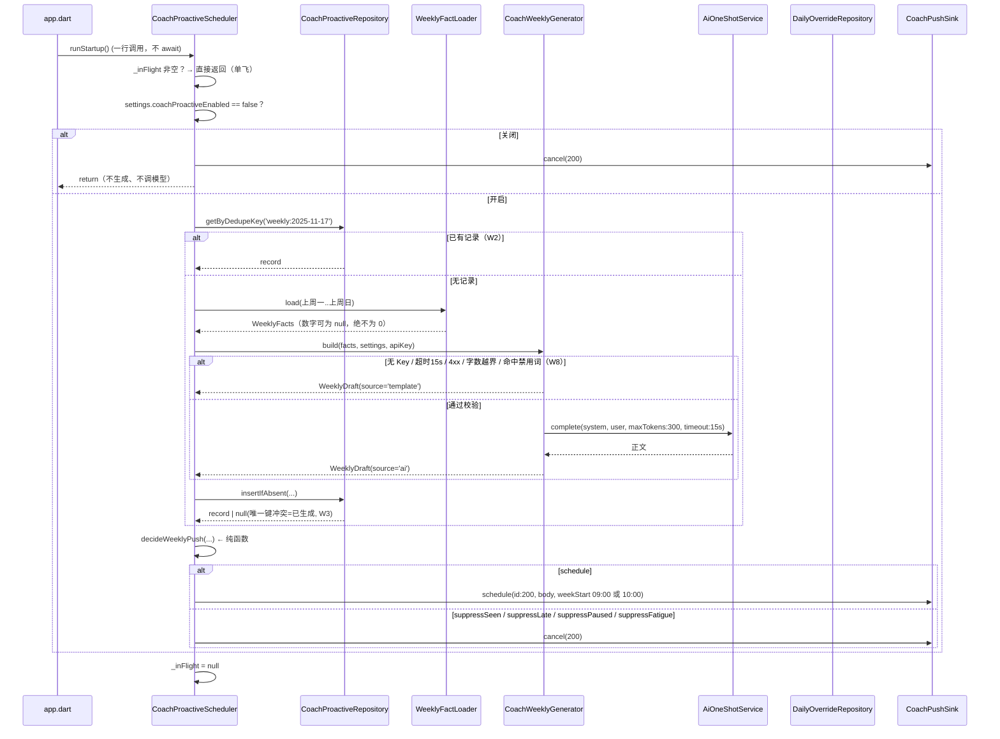
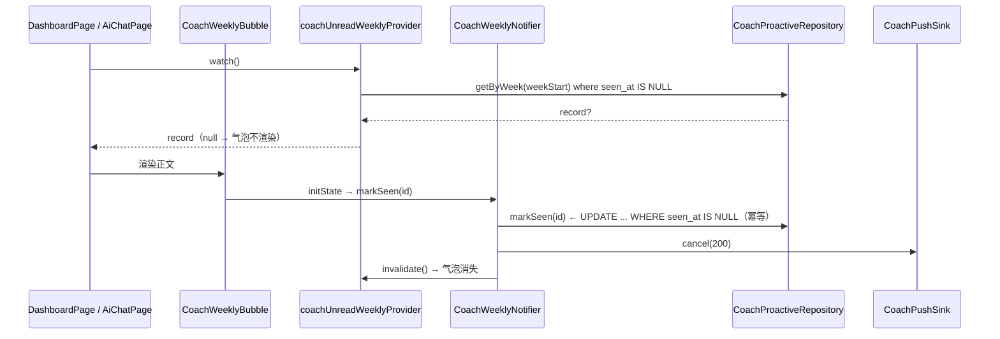
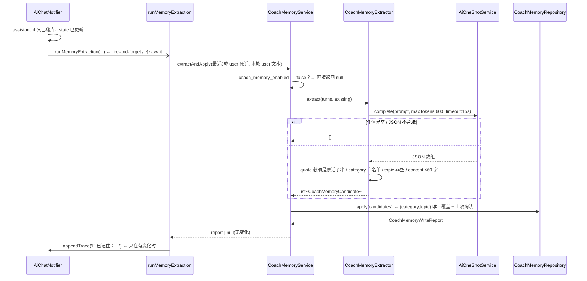
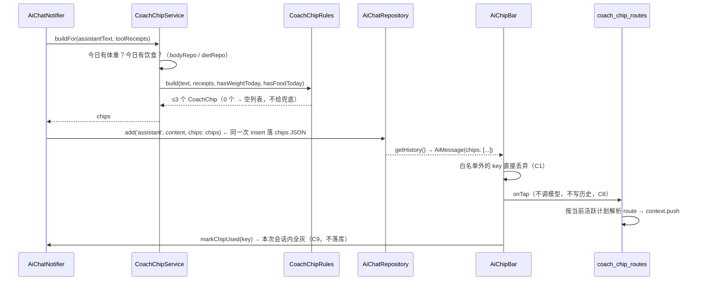
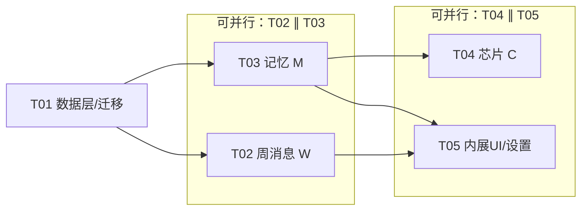

# 嘎教练 P0 增量 — 系统架构与任务拆解

> 需求源：`docs/spec/COACH-P0-ENGAGEMENT.md`（39 条 P0 规则 + P 组隐私回归）
> 宪法：`PROJECT.md`（减脂优先 / UI 薄 Notifier 厚 / 文件行数上限 / 无手动版本号）
> 铁律：`DEVELOPMENT_PLAYBOOK.md`（异步一律 Riverpod、迁移铁律、`bash scripts/check.sh` 门禁）
> 基线代码：schema v23 / `AiPromptBuilder`(291) / `ai_chat_notifier`(298) / `app.dart`(292)
> 本文只做设计，不含业务实现；所有 Dart 代码块都是**签名草案**，不是可编译代码。

---

## 0. 一页结论

| 项 | 结论 |
|---|---|
| schema | v23 → **v24**：新增 2 表 + 2 布尔列 + 1 可空 TEXT 列，**无数据变换**（纯 DDL + 加列），按 playbook 7.4 不包事务，走幂等助手 |
| 新依赖 | **0 个**（现有 `http` / `drift` / `flutter_local_notifications` / `timezone` 足够） |
| 新增文件 | lib 24 个 + test 6 个 = **30 个新文件** |
| 修改文件 | 18 个（其中 `app.dart` 只加 3 行、`ai_coach_settings_page.dart` **净减行**） |
| 任务数 | **5 个**（T01 数据层 → T02∥T03 → T04∥T05） |
| 三个功能各自的"唯一入口" | 周消息 = `CoachProactiveScheduler`；记忆 = `CoachMemoryService`；芯片 = `CoachChipRules`（纯函数） |
| 相对 PRD 的修正 | 7 处，见第九章（其中 2 处是**必须改**：注入上限 8→4、唯一索引落点；1 处是 PRD 缺口：训练后点评无规则无验收） |

**三条设计主线**

1. **"生成"与"推送"彻底分离。** 生成只依赖本地数据 + 一个可选 AI 调用；推送只依赖一个纯函数决策（`decideWeeklyPush`）。这样 W5/W6/W7/W13/W14 五条规则全部可以在**没有数据库、没有通知插件**的纯单测里证伪。
2. **记忆是"用户说过的话"，不是"AI 的推断"。** 三道闸：抽取 prompt 白名单 → 本地 `quote` 子串校验 → `(category, topic)` 唯一覆盖。任何一道缺失都会在几轮之后变成"记忆里全是模型幻觉"。
3. **芯片是快捷键，不是对话轮次。** 所以它不写历史、不调模型、点击即置灰，且**持久化只存 key、不存 route**（route 在点击时按当时的活跃计划解析，避免"存下来的计划 id 已经不存在"）。

---

## 1. 架构总览

### 1.1 分层落点（为什么放这里）

```
core/database/           ← 纯存取，不含策略（沿 daily_override_repository 先例）
  coach_proactive_repository.dart      投递记录 + 去重键 + 已读
features/ai/data/
  coach_memory_repository.dart         记忆 CRUD + 唯一键覆盖 + 上限淘汰的**执行**
features/ai/domain/
  coach_memory.dart                    实体 + category 白名单 + topic 归一化
  coach_memory_policy.dart             纯函数：注入挑选 / 每条上限淘汰顺序 / 候选校验
  coach_chip.dart                      芯片键白名单 + JSON 编解码
  coach_chip_rules.dart                纯函数：6 条生成规则（可单测，零 IO）
core/services/           ← 无状态编排（沿 reminder_scheduler / sick_day_gate 先例）
  coach_proactive_scheduler.dart       生成 + 排期 + 单飞 + 幂等
  coach_weekly_facts.dart              7 个数字的取数（DTO，不拼文案）
  coach_weekly_template.dart           模板兜底 + 目标句 + 字数/禁用词校验（纯）
  coach_weekly_prompt.dart             AI 版 system/user prompt（独立文件，不碰四层结构）
  coach_memory_service.dart            抽取编排 + 注入行生成 + 开关判定
  coach_memory_prompt.dart             抽取 prompt（独立文件）
  ai_oneshot_service.dart              非流式轻量调用（≤600 tokens，15s 超时）
```

**为什么不塞进 `app.dart` / `ai_prompt_builder.dart` / `ai_coach_settings_page.dart`**：
这三个文件分别是 292 / 291 / 299 行，都已经贴着或超过纪律上限（Page 300 / 其余无硬限但项目遵守同一口径）。
本设计对它们的改动只有**调用点**和**一小段拼装**，全部逻辑在新区文件里。

### 1.2 类图

见 `docs/design/coach-class-diagram.mermaid`（同内容内嵌）：

```mermaid
classDiagram
  class CoachProactiveScheduler {
    -CoachProactiveRepository repo
    -WeeklyFactLoader facts
    -CoachWeeklyGenerator generator
    -CoachPushSink push
    -DailyOverrideRepository overrides
    -Future~void~? _inFlight
    +runStartup() Future~void~
    +ensureWeeklyGenerated() Future~void~
    +syncPush() Future~void~
    +markSeen(int id) Future~void~
  }
  class WeeklyFacts {
    +DateTime weekStart
    +int workoutCount
    +int workoutMinutes
    +double? weightStartJin
    +double? weightEndJin
    +int weighInDays
    +double? totalLossJin
    +double? remainingJin
    +String? nickname
    +bool get weightChangeKnown
  }
  class CoachWeeklyGenerator {
    +build(WeeklyFacts, UserSettingsEntity?, String? apiKey) Future~WeeklyDraft~
  }
  class CoachWeeklyTemplate {
    <<static>>
    +render(WeeklyFacts) String
    +goalLine(int workoutCount) String
    +isAcceptable(String) bool
    +kBannedWords
  }
  class CoachPushSink {
    <<interface>>
    +schedule(int id, String title, String body, DateTime when) Future
    +cancel(int id) Future
  }
  class CoachMemoryService {
    -CoachMemoryRepository repo
    -CoachMemoryExtractor extractor
    -UserSettingsRepository settings
    +promptLines(int limit) Future~List~String~~
    +extractAndApply(...) Future~CoachMemoryWriteReport?~
    +listAll() Future~List~CoachMemory~~
    +delete(int id) Future~CoachMemory?~
    +restore(CoachMemory) Future~void~
    +clearAll() Future~int~
  }
  class CoachMemoryExtractor {
    +extract(List~String~ userTurns, List~CoachMemory~ existing) Future~List~CoachMemoryCandidate~~
  }
  class CoachMemoryCandidate {
    +String category
    +String topic
    +String content
    +String quote
    +String action
    +double confidence
  }
  class CoachMemory {
    +int id
    +String category
    +String topic
    +String content
    +String quote
    +int? sourceMessageId
    +DateTime createdAt
    +DateTime updatedAt
    +DateTime? lastUsedAt
  }
  class CoachChipRules {
    <<static>>
    +build(String text, List~String~ receipts, bool hasWeightToday, bool hasFoodToday) List~CoachChip~
  }
  class CoachChip {
    +String key
    +String get label
  }
  class CoachChipService {
    -BodyMetricRepository body
    -DietRepository diet
    +buildFor(String assistantText, List~String~ receipts) Future~List~CoachChip~~
  }
  class AiPromptBuilder {
    +build(TrendsData, UserSettingsEntity?, List~String~ memoryLines) String
  }
  class AiOneShotService {
    <<static>>
    +complete(String apiKey, List~AiMessage~, int maxTokens, Duration timeout) Future~String~
  }
  class CoachProactiveMessage {
    +int id
    +String kind
    +String dedupeKey
    +String content
    +String source
    +DateTime? weekStart
    +int? workoutId
    +DateTime createdAt
    +DateTime? seenAt
  }

  CoachProactiveScheduler --> CoachProactiveRepository
  CoachProactiveScheduler --> WeeklyFactLoader
  CoachProactiveScheduler --> CoachWeeklyGenerator
  CoachProactiveScheduler --> CoachPushSink
  CoachProactiveScheduler --> DailyOverrideRepository
  CoachWeeklyGenerator --> CoachWeeklyTemplate
  CoachWeeklyGenerator --> AiOneShotService
  WeeklyFactLoader --> WeeklyFacts
  CoachMemoryService --> CoachMemoryRepository
  CoachMemoryService --> CoachMemoryExtractor
  CoachMemoryExtractor --> AiOneShotService
  CoachMemoryExtractor --> CoachMemoryCandidate
  CoachMemoryRepository --> CoachMemory
  CoachChipService --> CoachChipRules
  CoachChipRules --> CoachChip
  AiPromptBuilder ..> CoachMemory : memoryLines(纯字符串，不耦合实体)
```



> 关键一处解耦：`AiPromptBuilder` 只接受 `List<String> memoryLines`（已格式化好的行），
> **不 import** `CoachMemory`。这样 291 行的 builder 只多 6 行，也不必把 feature 实体倒灌进 core。

### 1.3 时序图

四张图分别落盘：`coach-sequence-diagram.mermaid`（S1）、`coach-sequence-2-seen.mermaid`（S2）、
`coach-sequence-3-memory.mermaid`（S3）、`coach-sequence-4-chip.mermaid`（S4）。以下为同内容内嵌。

**S1 — 启动 / 回前台：生成 + 排期（幂等 + 单飞）**



**S2 — 首屏渲染 → 写 `seen_at` → 取消推送（W5 / W11）**



**S3 — 一轮对话：记忆抽取 + 留痕（M2 / M12）**



**S4 — 芯片：生成 → 渲染 → 点击（C1~C9）**



---

## 2. 数据层设计（schema v23 → v24）

### 2.1 表 `coach_proactive_messages`（新增）

| 列 | Dart | SQL 类型 | 约束 / 默认 | 说明 |
|---|---|---|---|---|
| `id` | `IntColumn get id` | INTEGER | PK AUTOINCREMENT | |
| `kind` | `TextColumn get kind` | TEXT NOT NULL | 无默认 | `weekly` / `workout_recap` |
| `dedupe_key` | `TextColumn get dedupeKey` | TEXT NOT NULL | **UNIQUE（见 2.4）** | `weekly:{yyyy-MM-dd}` / `recap:{workoutId}` |
| `content` | `TextColumn get content` | TEXT NOT NULL | 无默认 | 正文（模板或 AI） |
| `source` | `TextColumn get source` | TEXT NOT NULL | 无默认 | `ai` / `template` |
| `week_start` | `DateTimeColumn get weekStart` | INTEGER | **NULL** | 该周周一 00:00（本地）；点评为空 |
| `workout_id` | `IntColumn get workoutId` | INTEGER | **NULL** | 点评用；**不建外键**（见下） |
| `created_at` | `DateTimeColumn get createdAt` | INTEGER NOT NULL | `currentDateAndTime` | |
| `seen_at` | `DateTimeColumn get seenAt` | INTEGER | **NULL** | 渲染时写；null = 未读 |

```dart
// 与 v24 迁移块里的 CREATE INDEX IF NOT EXISTS 名字必须逐字一致
@TableIndex(name: 'idx_coach_proactive_created_at', columns: {#createdAt})
class CoachProactiveMessages extends Table {
  IntColumn get id => integer().autoIncrement()();
  TextColumn get kind => text()();
  TextColumn get dedupeKey => text()();
  TextColumn get content => text()();
  TextColumn get source => text()();
  DateTimeColumn get weekStart => dateTime().nullable()();
  IntColumn get workoutId => integer().nullable()();
  DateTimeColumn get createdAt => dateTime().withDefault(currentDateAndTime)();
  DateTimeColumn get seenAt => dateTime().nullable()();

  @override
  List<Set<Column>> get uniqueKeys => [{dedupeKey}];
}
```

**为什么 `workoutId` 不建外键**：`wipeAll` 会 `DELETE FROM workouts`（不是级联删），
若这里挂了 `references(Workouts, #id)`，`PRAGMA foreign_keys=ON` 时清空会因约束失败整段回滚 ——
而 `DataWipeService` 是先删 `workouts` 后删投递记录。投递记录是"已经发出去的历史"，
训练被删了这条文案依然成立（正文已经渲染过），所以用**弱引用**（int，没有约束）是正确语义。

### 2.2 表 `coach_memories`（新增）

| 列 | Dart | SQL 类型 | 约束 / 默认 | 说明 |
|---|---|---|---|---|
| `id` | `IntColumn get id` | INTEGER | PK AUTOINCREMENT | |
| `category` | `TextColumn get category` | TEXT NOT NULL | 无默认 | 5 值白名单，**写侧校验**（repository 不在 SQL 上做 CHECK，避免改白名单要迁移） |
| `topic` | `TextColumn get topic` | TEXT NOT NULL | 无默认 | 归一化短标签，≤20 字 |
| `content` | `TextColumn get content` | TEXT NOT NULL | 无默认 | ≤60 字（用户可读的一句话） |
| `quote` | `TextColumn get quote` | TEXT NOT NULL | 无默认 | 用户原话片段，≤60 字。**NOT NULL 是防腐层的物理落点** |
| `source_message_id` | `IntColumn get sourceMessageId` | INTEGER | NULL | 可追溯到哪条 user 消息；**不建外键**（清聊天记录不清记忆，P-1） |
| `created_at` | `DateTimeColumn get createdAt` | INTEGER NOT NULL | `currentDateAndTime` | |
| `updated_at` | `DateTimeColumn get updatedAt` | INTEGER NOT NULL | `currentDateAndTime` | 覆盖时更新 |
| `last_used_at` | `DateTimeColumn get lastUsedAt` | INTEGER | NULL | 注入时更新；淘汰依据 |

```dart
class CoachMemories extends Table {
  IntColumn get id => integer().autoIncrement()();
  TextColumn get category => text()();
  TextColumn get topic => text()();
  TextColumn get content => text()();
  TextColumn get quote => text()();
  IntColumn get sourceMessageId => integer().nullable()();
  DateTimeColumn get createdAt => dateTime().withDefault(currentDateAndTime)();
  DateTimeColumn get updatedAt => dateTime().withDefault(currentDateAndTime)();
  DateTimeColumn get lastUsedAt => dateTime().nullable()();

  @override
  List<Set<Column>> get uniqueKeys => [
        {category, topic},
      ];
}
```

**不建 `idx_coach_memories_category`**：这张表的天花板是 20 行，索引的收益为 0、写放大为正。

### 2.3 `user_settings` 新增 2 列 + `ai_chat_messages` 新增 1 列

| 表 | 列 | Dart | 默认 | 迁移写法 | 老数据行为 |
|---|---|---|---|---|---|
| `user_settings` | `coach_memory_enabled` | `BoolColumn get coachMemoryEnabled` | `Constant(true)` | `addColumnIfNotExists` | 生成 `ADD COLUMN ... NOT NULL DEFAULT 1`，老行自动读 `true` |
| `user_settings` | `coach_proactive_enabled` | `BoolColumn get coachProactiveEnabled` | `Constant(true)` | 同上 | 同上 |
| `ai_chat_messages` | `chips` | `TextColumn get chips`（**nullable**） | 无 | `addColumnIfNotExists` | 老行 `NULL` = 无芯片，天然兼容 |

```dart
// UserSettings 内追加（放在 nickname / avatarPath 之后，与迁移顺序一致）
BoolColumn get coachMemoryEnabled =>
    boolean().withDefault(const Constant(true))();
BoolColumn get coachProactiveEnabled =>
    boolean().withDefault(const Constant(true))();

// AiChatMessages 内追加
TextColumn get chips => text().nullable()();
```

**两个布尔列必须带 `withDefault`**：`ALTER TABLE ADD COLUMN` 加 NOT NULL 列时 SQLite 要求有默认值，
否则老库升级直接抛错（这是 v24 唯一的"必崩点"）。`chips` 允许 NULL，所以不需要默认值 ——
**且不能给默认空串 `''`**：`''` 与 `null` 会被解析成同一种"没有"但写了两套口径，未来统计"多少条消息带芯片"时会错。

### 2.4 唯一性为什么不用 `CREATE UNIQUE INDEX`

PRD 7.4(3) 要求"唯一索引与 `@TableIndex` 必须两处定义"。**这一条在 `dedupe_key` 上不适用**，理由：

- drift 的 `uniqueKeys` 会被写进 `CREATE TABLE ... UNIQUE(dedupe_key)` 语句里，
  而 `createTableIfNotExists` 在**两条路径上都执行**（`onCreate → createAll` 与 `onUpgrade → createTableIfNotExists`），
  所以唯一约束天然"两处生效"、单点定义。
- 反过来，若再手写 `CREATE UNIQUE INDEX idx_coach_proactive_dedupe ON ...`，
  SQLite 会同时存在 `sqlite_autoindex_coach_proactive_messages_1` 与这条命名索引 ——
  两个索引维护同一列，纯写放大。`daily_overrides.date` 的先例写得很清楚：
  "uniqueKeys 表达即可，**不要再额外建** idx_daily_overrides_date"。

**保留两处定义的只有普通索引**（`kV24Indexes` 常量 + `@TableIndex` 注解），与 v21 的 9 条同源。

**重复插入的判定（W3）**：

```dart
/// 返回 null = 该 dedupeKey 已存在（唯一约束拒绝），调用方视为"已生成"静默跳过。
Future<CoachProactiveMessage?> insertIfAbsent(
    CoachProactiveMessagesCompanion c) async {
  try {
    final id = await _db.into(_db.coachProactiveMessages).insert(c);
    return _getById(id);
  } catch (_) {
    // 唯一约束冲突 → 再读一次确认；读不到说明是别的错，原样抛
    final existing = await getByDedupeKey(c.dedupeKey.value);
    if (existing != null) return null;
    rethrow;
  }
}
```
用"回读确认"而不是匹配 `SQLITE_CONSTRAINT_UNIQUE` 错误码：drift 在不同 executor 下
包装出的异常类型不同（`SqliteException` / `DriftWrappedException`），错误码匹配会在某个平台上静默失效。

### 2.5 迁移（`database.dart` 的 v24 分支）

```dart
const int kSchemaVersion = 24;

/// v24 新增的普通索引（迁移侧定义）。名字必须与表类上的 @TableIndex 逐字一致。
const List<String> kV24Indexes = [
  'CREATE INDEX IF NOT EXISTS idx_coach_proactive_created_at '
      'ON coach_proactive_messages (created_at)',
];
```

`@DriftDatabase(tables: [...])` 末尾追加 `CoachMemories, CoachProactiveMessages`（顺序无所谓，无外键）。

`onUpgrade` 追加（放在 v23 块之后、`MigrationFailureMarker.clear` 之前）：

```dart
// v24: 教练主动消息 + 结构化记忆 + 两个开关列 + 芯片列
// 纯 DDL + 加列，无数据变换 → 按 playbook 7.4 不包事务；靠幂等助手收敛。
if (from < 24) {
  step = 'createTable:coach_memories';
  await createTableIfNotExists(m, coachMemories);
  step = 'createTable:coach_proactive_messages';
  await createTableIfNotExists(m, coachProactiveMessages);

  step = 'addColumn:coach_memory_enabled';
  await addColumnIfNotExists(m, userSettings, userSettings.coachMemoryEnabled);
  step = 'addColumn:coach_proactive_enabled';
  await addColumnIfNotExists(
      m, userSettings, userSettings.coachProactiveEnabled);

  // 半迁移现场 / 极老库兜底：表不在就跳过（v16 块本应已建过）
  step = 'addColumn:ai_chat_messages.chips';
  if (await _tableExists(this, 'ai_chat_messages')) {
    await addColumnIfNotExists(m, aiChatMessages, aiChatMessages.chips);
  }

  for (final sql in kV24Indexes) {
    step = 'index:${_indexNameOf(sql)}';
    await customStatement(sql);
  }
}
```

**升级路径收敛表**（每条都必须能跑通，`step` 用于失败诊断）：

| 起点 | 实际执行的块 | 结果 |
|---|---|---|
| 空库（新装） | `onCreate → createAll` | 2 表含 `UNIQUE` 约束；3 列带默认值/NULL；1 条索引（`@TableIndex`）；种子照旧 |
| v23 | 仅 v24 | 同上 |
| v22 | v23 + v24 | v23 的 `exercises.category` 合并 + v24 |
| v21 | v22 + v23 + v24 | 头像/昵称 + 分类合并 + v24 |
| v10~v20 | 对应缺失块 + v24 | 同上 |
| 半迁移（DDL 成功但 `user_version` 未推进） | 重跑同一块 | `createTableIfNotExists` / `addColumnIfNotExists` / `INDEX IF NOT EXISTS` 全部幂等收敛 |

**三条禁止**（playbook 7.5，写在这里是为了防止工程师顺手加）：
`onUpgrade` 里不许调 drift 的 `transaction()`（会 `ensureOpen` 死锁）、不许裸 `m.addColumn`、不许在 v24 块里写任何种子 `INSERT`。

### 2.6 与 `DataWipeService` 的接口

```dart
static const List<String> tableNames = [
  'workout_sets', 'workouts',
  'workout_template_exercises', 'workout_templates',
  'body_metrics', 'goals', 'photos', 'user_settings',
  'food_log', 'food_library', 'water_log',
  'ai_chat_messages', 'daily_overrides',
  'coach_memories',              // ← 新增：记忆是用户最私密的一段对话内容
  'coach_proactive_messages',    // ← 新增：投递记录清了正文却留着就是"没清干净"
  'weekly_report_cache',
];
```

- **删除顺序**：两张新表**无父子约束、无外键引用**，彼此也无关，所以顺序自由；
  放在 `weekly_report_cache` 之前（与 PRD 7.4(4) 一致）。真正有顺序要求的是 `workout_sets → workouts`
  与 `workout_template_exercises → workout_templates`（既有注释已写清）。
- **整表删**：`userScopeOf` 里**不登记**这两张表（没有内置数据混在里面），`deleteScopeOf` 返回 `''`。
- 事务行为不变：整段 `db.transaction()` 内执行，中途失败整体回滚。
- `user_settings` 本来就在清空列表里 → 两个开关随之回到默认值 `true`（等同新装），这是正确行为。

### 2.7 两个新 Repository 的接口

```dart
// lib/core/database/coach_proactive_repository.dart   （≤150 行）
class CoachProactiveRepository {
  CoachProactiveRepository(this._db);
  final AppDatabase _db;

  Future<CoachProactiveMessage?> getByDedupeKey(String key);
  Future<CoachProactiveMessage?> getWeekly(DateTime weekStart);

  /// 最近 N 条 weekly（按 week_start DESC），降频判定用（W14）
  Future<List<CoachProactiveMessage>> recentWeekly({int limit = 2});

  /// 返回 null = 唯一键冲突（已生成过），不是失败（W3）
  Future<CoachProactiveMessage?> insertIfAbsent(CoachProactiveMessagesCompanion c);

  /// 只在 seen_at IS NULL 时写；返回是否真的写了（幂等，W11）
  Future<bool> markSeen(int id, DateTime at);

  Future<int> deleteAll();
}

// lib/features/ai/data/coach_memory_repository.dart   （≤150 行）
class CoachMemoryRepository {
  CoachMemoryRepository(this._db);
  final AppDatabase _db;

  Future<List<CoachMemory>> listAll();                    // updatedAt DESC
  Future<int> count();
  Future<Map<String, int>> countByCategory();

  /// (category, topic) 命中就覆盖 content/quote/updatedAt，否则插入（M5）
  Future<CoachMemory?> upsert(CoachMemoriesCompanion c);

  /// 删该 (category, topic)；不存在返回 false，不抛（M6）
  Future<bool> deleteByKey(String category, String topic);
  Future<CoachMemory?> deleteById(int id);                // 供 M14 撤销用
  Future<void> reinsert(CoachMemory m);                   // 撤销（仍走唯一键覆盖路径）
  Future<void> touch(List<int> ids, DateTime at);         // M10 更新 last_used_at
  Future<int> deleteAll();
}
```

---

## 3. 主动消息模块（W 组）

### 3.1 `CoachProactiveScheduler` 的职责边界

只做四件事，**不做**文案生成、不做数据统计、不做通知插件调用：

| 方法 | 职责 | 调用时机 |
|---|---|---|
| `runStartup()` | `ensureWeeklyGenerated()` + `syncPush()`，单飞 | `app.dart` 的 `_bootstrap()` 与 `didChangeAppLifecycleState(resumed)` |
| `ensureWeeklyGenerated()` | 开关判定 → 取数 → 生成（模板/AI）→ `insertIfAbsent` | 同上（含在 runStartup 内） |
| `syncPush()` | 只做决策 + 排期/取消，**不生成、不调模型** | `runStartup` 内、`Reschedule` 之后（补回被 `cancelAll` 清掉的 200）、生病开关 apply/revoke 之后 |
| `markSeen(int id)` | 写 `seen_at` + `cancel(200)` | 气泡 / 教练页卡片首次渲染 |

```dart
class CoachProactiveScheduler {
  CoachProactiveScheduler({
    required CoachProactiveRepository repo,
    required WeeklyFactLoader facts,
    required CoachWeeklyGenerator generator,
    required CoachPushSink push,
    required UserSettingsRepository settings,
    required DailyOverrideRepository overrides,
    DateTime Function() now = DateTime.now,
  });

  /// 单飞：并发调用共享同一个 Future，不会生成两条（W2 的代码侧保险）
  Future<void>? _inFlight;
  Future<void> runStartup() => _inFlight ??= _run().whenComplete(() => _inFlight = null);

  Future<void> ensureWeeklyGenerated();
  Future<void> syncPush();
  Future<void> markSeen(int id);
}

/// 通知落点的抽象（**不复用 ReminderSink**：给抽象类加方法会打断既有单测假实现）
abstract class CoachPushSink {
  Future<void> schedule({
    required int id,
    required String title,
    required String body,
    required DateTime when,
  });
  Future<void> cancel(int id);
}
```

**为什么要单独一个 `CoachPushSink` 而不是给 `ReminderSink` 加方法**：`test/sick_day_reminder_scheduler_test.dart`
里有一个 fake `ReminderSink`，给接口加抽象方法会让它立刻编译失败 —— 那是 T03 的回归锁，
为了本期新功能去改它，等于把"T03 没退化"这条证据自己弄脏。

### 3.2 幂等与单飞的三层

| 层 | 手段 | 拦住什么 |
|---|---|---|
| 进程内 | `_inFlight` 共享 Future | 启动 + resume 几乎同时触发（真实场景：冷启动后立刻切回前台） |
| 数据层 | `dedupe_key` 唯一约束 | 两次生成都跑到 insert（外层都判定"无记录"）→ 第二条被数据库拒绝（W3） |
| 决策层 | `decideWeeklyPush` 纯函数 | 同一周重复排期 / 已读还推 / 迟到补推 |

### 3.3 生成流程的 5 级降级链（W8）

```dart
class CoachWeeklyGenerator {
  Future<WeeklyDraft> build({
    required WeeklyFacts facts,
    required UserSettingsEntity? settings,
    required String? apiKey,          // AiService.resolveKey(...) 的结果
    required DateTime now,
  }) async {
    final fallback = WeeklyDraft(
      content: CoachWeeklyTemplate.render(facts),
      source: 'template',
    );
    if (apiKey == null || apiKey.isEmpty) return fallback;      // ① 无 Key
    try {
      final text = await AiOneShotService.complete(
        apiKey: apiKey,
        messages: CoachWeeklyPrompt.messages(facts: facts, settings: settings),
        maxTokens: 300,
        temperature: 0.6,
        timeout: const Duration(seconds: 15),                   // ② 超时
      ).timeout(const Duration(seconds: 15));
      final trimmed = text.trim();
      if (!CoachWeeklyTemplate.isAcceptable(trimmed)) return fallback; // ③字数 ④禁用词
      return WeeklyDraft(content: trimmed, source: 'ai');       // ⑤ 通过
    } catch (e) {
      debugPrint('周消息 AI 生成失败，落模板: $e');               // 不重试、不排队
      return fallback;
    }
  }
}

class CoachWeeklyTemplate {
  /// 40 ≤ 字数 ≤ 120；且不含禁用词
  static bool isAcceptable(String s) {
    final n = s.runes.length;
    if (n < 40 || n > 120) return false;
    return !kBannedWords.any(s.contains);
  }

  /// 禁用词与 PRD 决策 1 逐字一致（改这里必须同步改验收 W-8）
  static const List<String> kBannedWords = [
    '保证', '一定能', '肯定瘦', '包瘦', '暴瘦', '一周瘦', '几天就',
  ];
}
```

**为什么 AI prompt 独立成文件**：`ai_prompt_builder.dart` 是 291 行、四层结构（角色/边界/格式/示例）
服务于**多轮对话**；周消息是**一次性短文**，两者的格式红线完全不同（对话要"像发微信"，
通知要"一眼看完且不误读"）。塞进 builder 要么破坏四层结构，要么让 builder 变成 if 分支大杂烩。

`CoachWeeklyPrompt` 的 system 段（要点，不是全文）：
角色（复用 `AiCoachOptions.styleOf(settings.aiStyle).personaLines` 的**语气**，让用户调过的"豆包感"生效）
+ 只许用给定数字、无数据就不提 + 不承诺速度 + 不提"消耗多少大卡" + 不出现"本周"字样 + 不用 Markdown + 40~120 字 + 一句话总结上周 + 一个本周小目标。

### 3.4 模板兜底需要的数据（W1 / W9）

```dart
class WeeklyFacts {
  final DateTime weekStart;      // 上周一 00:00（本地）
  final int workoutCount;        // 知道就是知道：0 是真实值（模板 3 用它）
  final int workoutMinutes;      // 0 也是真实值
  final double? weightStartJin;  // 上周首条体重；<2 次称重时为 null
  final double? weightEndJin;    // 上周末条体重
  final int weighInDays;         // 上周称重天数（去重）
  final double? totalLossJin;    // 当前累计减重（全期，需 ≥2 条记录）
  final double? remainingJin;    // 当前距目标（需有目标）
  final String? nickname;

  /// 只有两条都有值才谈得上"体重变化"
  bool get weightChangeKnown => weightStartJin != null && weightEndJin != null;
  double? get weightChangeJin =>
      weightChangeKnown ? weightEndJin! - weightStartJin! : null;
}
```

| 数字 | 来源 | 缺值时的表现（**绝不填 0**） |
|---|---|---|
| 训练次数 / 总时长 | `workoutRepo.getAll(from: 上周一, to: 上周日)` | 0 是真实值 → 走模板 3「没怎么练」 |
| 上周体重前后 | `bodyMetricRepo.getAll(from, to)`（升序，取 first/last） | <2 条 → `weightChangeKnown == false` → **整段不提体重** |
| 上周称重天数 | 同上，按自然日去重 | 0 → 追加「顺手记 3 天体重」 |
| 累计减重 | `bodyMetricRepo.getAll()` 全量 first/last，需 ≥2 条 | null → 不提 |
| 距目标剩余 | `settings.targetWeightKg` + 当前体重 | null → 不提 |
| 昵称 | `settings.nickname`（trim 后空视为未设置） | null → 不称呼 |

**模板按"段"拼装，而不是三条写死字符串**（这是对 PRD 6.3 的必要补齐，见第九章修正 3）：

```
seg1（必有）：workoutCount == 0
              ? '上周没怎么练，也没关系，减脂是长跑不是短跑。'
              : '上周练了 {N1} 次，一共 {N2} 分钟'（+ 体重变化句，仅当 weightChangeKnown）
seg2（可选）：weightChangeKnown → '体重从 {前} 走到 {后}。'
                                  或（|Δ| < 0.2 斤）'体重没动很正常，围度和状态会比秤先变。'
seg3（必有）：'这周{目标句}。' + （weighInDays < 3）'顺手记 3 天体重。'
```

目标句（W10，由 `workoutCount` 三档）：`0 → 先练 1 次，10 分钟也算` / `1~2 → 练 2 次，每次 15 分钟以上` / `≥3 → 保持 3 次`。

### 3.5 推送决策（纯函数，W4/W5/W6/W7/W14/W13）

```dart
enum CoachPushDecision {
  schedule,
  suppressDisabled,   // W13 总开关关
  suppressSeen,       // W5 已读
  suppressLate,       // W6 已过周一 09:00（含周一 10:00 才打开）
  suppressPaused,     // W7 周一 reminderPaused
  suppressFatigue,    // W14 连续 2 条未读
}

/// 周消息的推送时刻：默认该周周一 09:00；称重提醒也在 9 点 → 顺延 10:00（W4）
DateTime weeklyPushAt({required DateTime weekStart, required int? reminderHour}) =>
    DateTime(weekStart.year, weekStart.month, weekStart.day,
        reminderHour == 9 ? 10 : 9, 0);

CoachPushDecision decideWeeklyPush({
  required DateTime now,
  required DateTime weekStart,
  required int? reminderHour,
  required bool enabled,          // coach_proactive_enabled
  required bool seen,             // record.seenAt != null
  required bool pausedOnWeekStart,// 周一那天 daily_overrides.reminder_paused
  required bool fatigueSuppressed,// recentWeekly(2) 两条都未见
}) {
  if (!enabled) return CoachPushDecision.suppressDisabled;
  if (seen) return CoachPushDecision.suppressSeen;
  if (!now.isBefore(weeklyPushAt(weekStart: weekStart, reminderHour: reminderHour))) {
    return CoachPushDecision.suppressLate;      // 含"周一 09:00 之后"
  }
  if (pausedOnWeekStart) return CoachPushDecision.suppressPaused;
  if (fatigueSuppressed) return CoachPushDecision.suppressFatigue;
  return CoachPushDecision.schedule;
}

/// W14：最近 2 条 weekly 都未见 → 停推（仍生成、仍内展）
bool isFatigueSuppressed(List<CoachProactiveMessage> recentWeekly) {
  if (recentWeekly.length < 2) return false;
  return recentWeekly.take(2).every((m) => m.seenAt == null);
}

/// 本周一 00:00（本地时区）—— 全 App 唯一周口径
DateTime mondayOf(DateTime d) => DateTime(d.year, d.month, d.day - (d.weekday - 1));

String weeklyDedupeKey(DateTime weekStart) =>
    'weekly:${weekStart.year.toString().padLeft(4, '0')}-'
    '${weekStart.month.toString().padLeft(2, '0')}-'
    '${weekStart.day.toString().padLeft(2, '0')}';
```

**生病闸门联动的关系是单向的**：`CoachProactiveScheduler → DailyOverrideRepository`，
**不经过 `SickDayGate`**。理由：
`SickDayGate` 的构造函数是两个 repo（`DailyOverrideRepository` + `UserSettingsRepository`），
它承载的是"生病该降多少"的**策略与写侧校验**；周消息只需要读一个布尔。
若走 `SickDayGate`，会形成 `Scheduler → Gate → UserSettingsRepository` 与
`Scheduler → UserSettingsRepository` 两条路径，将来 gate 若引用 scheduler 就成环。
`ReminderScheduler` 读 gate 是因为它要复用 gate 的 `pausedToday()` 语义（含"读库失败就不暂停"的容错），
周消息的容错策略不同（读失败 → **不推**，见下），所以各读各的更安全。

**生病闸门的时序细节**：`daily_overrides` 是按天存储、过夜即失效。所以
"周一 `reminderPaused`"这个判定只有在**周一当天**读取才有意义；而非周一才首次生成时（W6 已 `suppressLate`），
周一那行早已不存在 —— 两条规则自洽，不存在"读不到历史 override"的漏洞。

**"当前时刻"用哪个时钟**：`decideWeeklyPush` 的 `now` 与 `weekStart` 都由注入的
`DateTime Function() now` 提供（单测可 fake），时区语义与 `NotificationService` 一致（`tz.local = Asia/Shanghai`）：
`weekStart` 用**本地 DateTime**（用于 dedupe key 与人读的日期），
`CoachPushSink.schedule` 内部再转 `tz.TZDateTime(tz.local, ...)` 交给 `zonedSchedule`。
**dedupe key 只用年月日**，不用"第几周编号"（跨年安全，PRD 已明确）。

### 3.6 "已读不推"与"周一 9 点后打开只内展"的落点（字段级）

| 判定 | 读哪张表哪一列 | 写在哪 |
|---|---|---|
| 用户已在 App 内看到过 | `coach_proactive_messages.seen_at != null`（当周那条） | `markSeen()`：`UPDATE ... SET seen_at = ? WHERE id = ? AND seen_at IS NULL` |
| 已排的通知要撤 | 通知 id 段位 `200` | `markSeen()` 末尾 `push.cancel(kCoachWeeklyNotificationId)` |
| 周一 09:00 已过 | `now` vs `weeklyPushAt(weekStart)`（纯计算，不落库） | 不排期，也不写任何状态（`seen_at` 保持 null → 内展照常） |
| 生病免推 | `daily_overrides.reminder_paused`（`date == weekStart` 那天） | 不排期 |
| 降频免推 | `recentWeekly(limit: 2)` 两条的 `seen_at` | 不排期（**不改任何行**，用户读到即自动恢复） |

`markSeen` 用 `WHERE seen_at IS NULL` 条件更新：重复渲染（首页 + 教练页同时进 build）不会把
"首次阅读时间"刷新成更晚的时间，也让 widget 重建天然幂等。

### 3.7 内展的两处 UI（W11）与两个 provider

PRD 6.1 状态机里有一处隐含要求必须显式化：
首页气泡「有未读才出现」→ 读后消失；教练页卡片「保留至下次周消息」→ 读后仍在。
所以需要**两个不同口径的 provider**：

```dart
/// 首页气泡：只在「本周有记录 + 未读 + 总开关开」时返回非 null
final coachUnreadWeeklyProvider =
    FutureProvider<CoachProactiveMessage?>((ref) async { ... });

/// 教练页顶部卡片：本周最新一条（已读也返回），仅受总开关约束
final coachLatestWeeklyProvider =
    FutureProvider<CoachProactiveMessage?>((ref) async { ... });
```

两个 widget：
- `lib/features/ai/presentation/widgets/coach_weekly_bubble.dart`
  - `CoachWeeklyBubble`（首页用，挂在 `dashboard_page.dart` 咕嘎卡片下方一行 `const CoachWeeklyBubble()`）
  - `CoachWeeklyCard`（教练页顶部，同文件导出）
  - 两者都是 `ConsumerStatefulWidget`，`initState` → `Future.microtask(() => notifier.markSeen(id))`，
    **绝不在 `build` 里写库**（build 会被频繁重建）。

首页卡片目前 216 行，插入 1 行后 217 行，安全。

### 3.8 通知能力与 id 段位

`NotificationService` 新增一个方法（不新增通道复用问题）：

```dart
Future<void> scheduleCoachWeekly({
  required int id,          // 200
  required String body,
  required tz.TZDateTime when,
}) async {
  await _plugin.cancel(id);
  await _plugin.zonedSchedule(
    id, '嘎教练说', body,
    when,
    const NotificationDetails(
      android: AndroidNotificationDetails(
        'coach_weekly', '教练周消息',
        channelDescription: '每周一条上周总结',
        importance: Importance.defaultImportance,   // 不是 high：这是"看的机会"，不是闹钟
        priority: Priority.defaultPriority,
      ),
      iOS: DarwinNotificationDetails(),
    ),
    uiLocalNotificationDateInterpretation:
        UILocalNotificationDateInterpretation.absoluteTime,
    // 一次性，不设 matchDateTimeComponents（那是重复提醒用的）
    androidScheduleMode: AndroidScheduleMode.inexactAllowWhileIdle,
  );
}
```

| 段位 | 用途 | 现状 |
|---|---|---|
| 0–99 | 训练提醒 | 现有 |
| 100–199 | 称重提醒（`kWeighInReminderId = 100`，101~106 为历史遗留） | 现有 |
| **200** | **周消息**（`const int kCoachWeeklyNotificationId = 200`） | 本期 |
| 8888 / 9999 | 训练常驻 / 体重反馈 | 现有 |

### 3.9 ⚠️ 一个必须处理的既有行为冲突（真实缺陷）

`ReminderScheduler.reschedule()` 第一步是 `await sink.cancelAll()` ——
**它会把 id=200 的周消息通知一起取消**。而 `app.dart` 的 `_scheduleOnStart()`
在"提醒开关打开"时每次启动 / 跨天 resume 都会调用它。结果：周消息排了又被打扫干净，
用户永远收不到推送，且**没有任何报错**（最难查的一类）。

处理方式（T02 内含，不改 `ReminderScheduler` 的既有语义）：

```dart
// app.dart::_scheduleOnStart() 末尾
await ref.read(reminderSchedulerProvider).reschedule(...);
await ref.read(coachProactiveSchedulerProvider).syncPush();  // ← 补回被 cancelAll 清掉的 200
```

同理 `settings_page.dart` 关闭「每日提醒」时调 `NotificationService().cancelAll()` ——
200 也会被清掉。这里**不新增调用**：用户下次进 App（`runStartup`）会自动补回，
而"刚关掉提醒的那一瞬间"本来就不该立刻冒出一条周消息。

---

## 4. 记忆模块（M 组）

### 4.1 `CoachMemoryService`

```dart
// lib/core/services/coach_memory_service.dart  （≤200 行）
class CoachMemoryService {
  CoachMemoryService({
    required CoachMemoryRepository repo,
    required CoachMemoryExtractor extractor,
    required UserSettingsRepository settings,
    DateTime Function() now = DateTime.now,
  });

  /// 注入用：≤[limit] 行（默认 4，见修正 1）。开关关 / 无数据 → 空列表（M15、边界"删光不留空标题"）
  /// 命中条目的 last_used_at 会被更新（M10）；任何异常 → 空列表（绝不打断对话）
  Future<List<String>> promptLines({int limit = 4});

  /// 对话轮结束后的唯一入口。返回 null = 本轮没有任何变化（M12 不留痕）
  Future<CoachMemoryWriteReport?> extractAndApply({
    required List<String> userTurns,   // 最近 ≤3 轮 user 原话（上下文）
    required String currentUserText,   // 本轮 user 原话（优先用来找 quote）
    int? sourceMessageId,
  });

  Future<List<CoachMemory>> listAll();      // M13
  Future<CoachMemory?> deleteById(int id);  // M14：返回被删行供撤销
  Future<void> restore(CoachMemory m);      // M14：5 秒撤销（走唯一键覆盖路径，防冲突）
  Future<int> clearAll();                   // M16
  Future<int> count();
}
```

### 4.2 抽取时机与输入（M2）

- **时机**：`AiChatNotifier._request()` 里"assistant 正文已落库 + `state` 已更新"之后的最后一步，
  `fire-and-forget`（不 `await`）。
- **不触发的情况**：本轮没有 user 消息（`retryLast` 的第二轮、工具回合的续轮）、
  `coach_memory_enabled == false`、无 API Key。
- **输入**：最近 3 轮 user 原话（含本轮）+ 已有记忆清单（category·topic·content 三列，**不含 quote**）
  + 5 类白名单 + 4 类明确不记（逐条列出）。
- **输出**：JSON 数组，每项 `{category, topic, content, quote, action, confidence}`。
  `action ∈ {remember, forget}`。
- **参数**：`maxTokens: 600`、`temperature: 0.2`、`timeout: 15s`、**不重试**、失败只 `debugPrint`。

```dart
// lib/features/ai/data/coach_memory_extractor.dart  （≤150 行）
class CoachMemoryExtractor {
  CoachMemoryExtractor({required UserSettingsRepository settings});

  /// 任何异常 / 非 JSON / 非数组 → 返回 []（失败静默）
  Future<List<CoachMemoryCandidate>> extract({
    required List<String> userTurns,
    required String currentUserText,
    required List<CoachMemory> existing,
    required String? apiKey,
  });
}
```

### 4.3 写入规则（M1/M3/M4/M5/M6/M7/M8/M9）

校验全部在 `coach_memory_policy.dart` 的纯函数里（可单测、无 IO），**按顺序**：

| 序 | 校验 | 不通过 | 规则 |
|---|---|---|---|
| 1 | `category ∈ {injury, diet, schedule, agreement, preference}` | 丢弃 | M3 |
| 2 | `quote` 非空 且 `quote` 是 `userTurns` 拼接文本的子串 | 丢弃 | M1（**防腐层**） |
| 3 | `topic` 归一化（trim + 折叠空白 + 转小写 + 去首尾标点）后非空、≤20 字 | 丢弃 | M7 |
| 4 | `content` 非空、≤60 字 | 丢弃 | M8 |
| 5 | 数字型身体数据 / 隐私标识 / 医疗结论的**本地兜底拦截**（正则：体重/斤/kg 数值、手机号、身份证、诊断口吻"你有…炎"） | 丢弃 | M4 |
| 6 | `action == forget` → 删该 `(category, topic)`；不存在 **不抛错、不计数** | — | M6 |
| 7 | 否则 upsert：`(category, topic)` 命中即覆盖 `content/quote/updated_at` | 不新增行 | M5 |

```dart
class CoachMemoryPolicy {
  static const Set<String> categories = {
    'injury', 'diet', 'schedule', 'agreement', 'preference',
  };

  /// 写入侧每类上限（修正 1：比 PRD 的"每类 5 条"更紧，防某一类挤满名额）
  static const Map<String, int> perCategoryCap = {
    'injury': 5, 'diet': 3, 'schedule': 3, 'agreement': 3, 'preference': 3,
  };
  static const int totalCap = 20;

  /// 注入优先级（安全 > 承诺 > 饮食 > 作息 > 偏好）
  static const List<String> injectionOrder = [
    'injury', 'agreement', 'diet', 'schedule', 'preference',
  ];

  static String? normalizeTopic(String raw);
  static String? validate(CoachMemoryCandidate c, String haystack);
  static bool looksLikeForbidden(String content);           // 数字/隐私/诊断兜底

  /// 超限淘汰：返回应删除的 id（injury 永不入选）
  static List<int> evictionsNeeded({
    required List<CoachMemory> all,
    required String incomingCategory,
  });

  /// 注入挑选：injury 全量优先（≤limit），其余按 injectionOrder 补足
  static List<CoachMemory> selectForPrompt(List<CoachMemory> all, int limit);
}
```

**淘汰规则（M9 + 修正 1）**：
1. 先按 category 查现有条数；若 `incomingCategory` 已满 `perCategoryCap[category]` →
   淘汰该类中 `last_used_at` 最早者（`last_used_at == null` 视为最早，`created_at` 兜底比较）。
2. `injury` 类**不参与淘汰**，且它的 cap 是 5（写入侧最多 5 条伤病，超出直接丢弃新条目而不是挤掉旧的）。
3. 总量 20 是硬闸：任何写入后若 `count > 20`，从**非 injury** 中淘汰 `last_used_at` 最早者直到 ≤20。
4. 语义解释（写进代码注释）：`last_used_at` 是"最近被注入过"的代理，比"最早的先删"更符合直觉。

### 4.4 注入（M10 / M11）

```dart
// ai_prompt_builder.dart 唯一改动：签名 + 6 行拼装（不 import 任何 feature 实体）
static String build({
  required TrendsData trends,
  UserSettingsEntity? settings,
  List<String> memoryLines = const [],   // ← 新增，默认空 → 所有既有调用点零改动
}) {
  // ... 原 211~221 行不变（# 用户数据 + 新用户引导）
  if (memoryLines.isNotEmpty) {
    buf
      ..writeln()
      ..writeln('# 你记得的事（用户以前亲口说过的长期情况，直接用，不要复述给他听）');
    for (final line in memoryLines) {
      buf.writeln('- $line');
    }
  }
  // ... 原「# 用户额外约束」段不变
}
```

**位置合规性**：`【用户数据】` 段（`_dataLines`）之后、`用户额外约束` 之前 —— 满足 M11。
用户手写约束优先级最高（放最后），记忆是被动事实，放它前面。

**不改调用点签名**：现有调用共 30 处（生产 3 处：`ai_chat_notifier.dart:186`、`ai_persona_page.dart:130/135`；
测试 27 处：`ai_service_test` 15、`ai_start_workout_test` 3、`ai_web_search_toggle_test` 2、`ai_persona_custom_test` 2、
`ai_message_vision_test` 2、`web_tools_test` / `ai_log_food_macros_test` / `ai_chat_tool_failure_test` 各 1）
全部只用命名可选参数 → 新增带默认值的参数**零破坏**。
唯一需要"接线"的是 `ai_chat_notifier._request()`：

```dart
// _request() 内（已在 try 里）
final memoryLines = _memoryLinesCache ??=
    await _ref.read(coachMemoryServiceProvider).promptLines();
...
content: AiPromptBuilder.build(
  trends: trends, settings: settings, memoryLines: memoryLines),
```

```dart
/// 每轮只读一次：工具回合会递归 2~4 次 `_request()`，不缓存就会把 last_used_at 刷 4 遍
List<String>? _memoryLinesCache;

void _resetToolContext() {
  _tool.reset();
  _stallNudgeCount = 0;
  _memoryLinesCache = null;   // send / retry / clear 时失效 → 删完记忆下一轮立刻生效
}
```

**注入格式**：每行 `category·content`（如 `伤病·右膝半月板有旧伤`），**不带 quote**（M11：
防 prompt 膨胀、防原话细节外泄）。`promptLines()` 内部用 `CoachMemoryPolicy.selectForPrompt` 挑选，
然后用 `repo.touch(ids)` 更新 `last_used_at`。

### 4.5 对话内留痕（M12）

```dart
class CoachMemoryWriteReport {
  final List<CoachMemory> added;
  final List<CoachMemory> updated;
  final List<String> forgotten;   // 被 forget 的 topic 文案
  final int evicted;
  bool get isEmpty => added.isEmpty && updated.isEmpty && forgotten.isEmpty;
  String get summary;             // 「右膝有旧伤 · 晚上十点后不吃东西」，>3 条时「A · B · C 等 N 条」
}
```

`lib/features/ai/data/ai_chat_memory_flow.dart`：

```dart
Future<void> runMemoryExtraction({
  required CoachMemoryService service,
  required List<String> userTurns,
  required String currentUserText,
  required int? sourceMessageId,
  required Future<void> Function(String text) appendTrace,
}) async {
  try {
    final report = await service.extractAndApply(...);
    if (report == null || report.isEmpty) return;
    await appendTrace('🧠 已记住：${report.summary}'
        '（可在 教练设定 → 教练记得的事 里删）');
  } catch (e) {
    debugPrint('记忆抽取失败（不影响对话）: $e');
  }
}
```

**只多 1 条消息、多条合并、无变化不留痕**（M12）。落库失败不影响对话（`appendTrace` 内部已吞异常）。
`🧠` 前缀同时是 C6 的"工具留痕不挂芯片"判据之一 —— 两个功能在这一点上互相保护。

### 4.6 「可见可删可关」UI

| 文件 | 行数预算 | 内容 |
|---|---|---|
| `lib/features/ai/presentation/pages/coach_memory_page.dart` | ≤260 | 页头说明（PRD 定稿文案）+ 开关关时的灰化提示 + 5 类分组列表（每组标题带条数）+ 空态 + 底部「清除全部记忆」按钮 |
| `lib/features/ai/presentation/notifiers/coach_memory_notifier.dart` | ≤150 | `AsyncNotifier<List<CoachMemory>>`：`delete(id)`（不弹确认，返回被删行）、`undo(CoachMemory)`、`clearAll()`（**先弹 AlertDialog 二次确认**，由 Page 弹、Notifier 只执行）、`toggleEnabled(bool)` |
| `lib/features/ai/presentation/coach_memory_providers.dart` | ≤60 | `coachMemoryRepoProvider` 之外的 service/extractor/list provider |
| `lib/features/ai/presentation/widgets/coach_engagement_section.dart` | ≤140 | 设置页的整段「教练的主动性」：记忆开关 + 「教练记得的事」入口 + 主动消息开关（关闭时弹 PRD 定稿确认文案）+ 把现有「人设文案」入口一并搬进来 |

**为什么"删单条不弹确认、删全部要弹"**：删除单条是"回到安全态"（与 T03 决策 3 同源），
加二次确认会让用户懒得清理；而清除全部是不可撤销的破坏性操作，确认策略必须不同。
撤销走 `SnackBar(action: '撤销')`，5 秒；实现上不是"移动行到回收站"，而是 `deleteById` 返回实体 →
撤销时 `restore()` 重新插入（走 `(category, topic)` 唯一键覆盖路径，5 秒内被新记忆占用也不会撞键）。

**`ai_coach_settings_page.dart`（299 行）怎么塞进入口而不超 300**：

```
现状：第 271~281 行是「人设文案」Card（11 行）
改法：把这 11 行换成 1 行 `const CoachEngagementSection()`（模板入口搬进 section 内部）
净变化：-10 行 → 289 行，然后 section 里再加入口 = 页面本身不再增长
```

**开关语义（M15 / W13）**：
`coach_memory_enabled == false` → 不写（抽取入口直接 return）、不注入（`promptLines()` 返回 `[]`）、
不留痕（`extractAndApply` 返回 null）、页面灰化 + 顶部提示；**数据保留**（关 ≠ 删）。

### 4.7 与 `wipeAll` / 清空聊天记录的关系（M16 / P-1）

| 动作 | 影响 `coach_memories` | 影响 `ai_chat_messages` |
|---|---|---|
| `clearHistory()`（清空聊天记录） | **不动** | 全删 |
| 「清除全部记忆」按钮 | 全删 | **不动** |
| `wipeAll` | 全删（`tableNames` 已含） | 全删 |

三者互不串台 —— 这正好是 P-1 的证伪点：两个 clear 动作交叉验证。

---

## 5. 芯片模块（C 组）

### 5.1 数据模型（修正 4：存 key，不存 route）

```dart
// lib/features/ai/domain/coach_chip.dart  （≤100 行）
class CoachChip {
  /// 白名单 key：open_workout / log_weight / log_food / set_reminder / open_trends
  final String key;
  const CoachChip(this.key);

  String get label => labels[key] ?? '';

  static const Map<String, String> labels = {
    'open_workout': '去开练',
    'log_weight': '记体重',
    'log_food': '记饮食',
    'set_reminder': '设提醒',
    'open_trends': '看趋势',
  };

  /// 落库格式：JSON 数组字符串，如 `[{"k":"log_weight"}]`；null/''/非法 → 空列表
  static List<CoachChip> decode(String? raw);
  static String? encode(List<CoachChip> chips);   // 空列表 → null（不写 '[]'）
}
```

**为什么不存 `route`**：「去开练」的落点依赖**当时的**活跃计划
（有 → `/plan/{id}/execute`，无 → `/workout/quick-start`）。把 route 存进消息 JSON，
用户删掉计划之后点那个芯片就是白屏或错误页 —— 而这正是本仓库反过的坑
（`app_router.dart` 里那些 `/goals`、`/settings/body-info` 的 redirect 就是为这个坑留的）。
**payload 也没有必要存**：5 个 key 都不需要参数（`recap` 才需要 workoutId，而它不是芯片）。

### 5.2 生成器（C2 / C3 / C4 / C5）

```dart
// lib/features/ai/domain/coach_chip_rules.dart  （≤140 行，纯函数，零 IO）
class CoachChipRules {
  static const int maxChips = 3;

  /// 判定顺序即优先级，命中即收集，同一 key 不重复，取前 3 个
  static List<CoachChip> build({
    required String assistantText,
    required List<String> toolReceipts,   // 本轮 role=tool 的正文（JSON 字符串）
    required bool hasWeightToday,
    required bool hasFoodToday,
  }) {
    final out = <CoachChip>[];
    void add(String key) {
      if (out.length >= maxChips) return;
      if (out.any((c) => c.key == key)) return;
      out.add(CoachChip(key));
    }

    // ① 本轮 start_workout 回执 ok:false → 去开练
    final startFailed = toolReceipts.any((r) =>
        r.contains('"ok":false') && r.contains('start_workout') ||
        r.contains('"tool":"start_workout"') && r.contains('"ok":false'));
    if (startFailed) add('open_workout');

    // ② 正文含 开练 / 开始训练 / 模板
    if (_has(assistantText, const ['开练', '开始训练', '模板'])) add('open_workout');
    // ③ 体重 / 称重 / 上秤 —— 且今日无体重记录
    if (_has(assistantText, const ['体重', '称重', '上秤']) && !hasWeightToday) {
      add('log_weight');
    }
    // ④ 吃 / 热量 / 蛋白 / 碳水 / 饮食 —— 且今日无饮食记录
    if (_has(assistantText, const ['吃', '热量', '蛋白', '碳水', '饮食']) && !hasFoodToday) {
      add('log_food');
    }
    // ⑤ 提醒 / 几点 / 早点睡 / 作息
    if (_has(assistantText, const ['提醒', '几点', '早点睡', '作息'])) add('set_reminder');
    // ⑥ 趋势 / 进度 / 变化 / 这周 / 上周
    if (_has(assistantText, const ['趋势', '进度', '变化', '这周', '上周'])) add('open_trends');

    return out;   // 一条都不命中 → 空列表，不给兜底芯片（C4）
  }
}
```

> ①的字面判据需要和 `AiToolContext.failureReceipt` 的实际输出格式对齐（T04 开工前先读该文件确认
> JSON 字段名），这是实现细节而不是设计假设 —— **写进 T04 的验收**：先跑一条 `start_workout` 失败用例打印真实回执。

**为什么纯函数 + 独立 service**：6 条规则必须"每一条都能单独证伪"（C-2），
而"今日有无记录"是 IO。把 IO 抽到 `CoachChipService` 后，规则本身可以不做任何 mock 直接单测。

```dart
// lib/features/ai/data/coach_chip_service.dart  （≤80 行）
class CoachChipService {
  CoachChipService({required BodyMetricRepository body, required DietRepository diet});

  /// 任何 IO 异常 → 返回 []（"芯片生成异常不影响消息本身"，PRD 第八章）
  Future<List<CoachChip>> buildFor({
    required String assistantText,
    required List<String> toolReceipts,
  }) async {
    try {
      final today = DateTime.now();
      final hasWeight = (await _body.getAll(from: today, to: today)).isNotEmpty;
      final hasFood = await _diet.getDailyCalories(today) > 0;  // 用既有口径
      return CoachChipRules.build(...);
    } catch (_) {
      return const [];
    }
  }
}
```

### 5.3 渲染与交互（C6 / C8 / C9）

| 项 | 设计 |
|---|---|
| 渲染位置 | `ai_chat_bubbles.dart` 的 `AiChatBubble.assistant` 内部、`Text` 下方（复制按钮之上），新增文件 `ai_chip_bar.dart`（≤140 行） |
| 只挂 assistant 且非留痕 | `AiChatBubble` 新增可选 `List<CoachChip> chips`；`AiMessageList` 传 `m.chips`；`canCopy/pending` 为 false 时不渲染芯片 |
| 留痕消息不挂 | C6 三重判据：① 流式中（`pending`/`isStreaming`）② 正文以 `✅`/`🚫`/`🧠` 开头 ③ 周消息从不进 `ai_chat_messages`（W12）所以天然不会出现在这里 |
| 点击 | `CoachChipRouter.open(context, ref, chip)`：解析 route → `context.push`；**不调模型、不写历史**（C8） |
| 置灰 | `AiChatState.usedChipKeys: Set<String>` + `markChipUsed(key)`；`AiChipBar` 里 `onPressed: used.contains(key) ? null : ...`（C9，不落库，重启复活） |
| 白名单外 key | `CoachChip.decode` 直接丢弃（C1）；`CoachChipRules` 只会产出白名单 key（双保险） |

```dart
// lib/features/ai/presentation/widgets/ai_chip_bar.dart 内的路由解析
Future<void> openCoachChip(BuildContext context, WidgetRef ref, CoachChip chip) async {
  switch (chip.key) {
    case 'open_workout':
      final plans = await ref.read(planRepoProvider).getAll();
      final active = plans.where((p) => p.isActive).toList();
      if (!context.mounted) return;
      context.push(active.isEmpty
          ? '/workout/quick-start'
          : '/plan/${active.first.id}/execute');
    case 'log_weight':
      context.push('/body?focus=weight');     // 焦点落到体重输入框
    case 'log_food':
      context.push('/diet?add=1');            // 直接弹录入
    case 'set_reminder':
      context.push('/profile');
      ScaffoldMessenger.maybeOf(context)?.showSnackBar(
        const SnackBar(content: Text('在「每日提醒」里改时间与开关')));
    case 'open_trends':
      context.push('/trends');
  }
}
```

**两个已有页面的最小改动**（为了让"点了就到录入"真的成立）：

| 文件 | 改动 | 行数 |
|---|---|---|
| `body_metric_page.dart`(183) | `initState` 后读取 `GoRouterState.of(context).uri.queryParameters['focus']`，传 `focusWeight: true` 给 `AddMetricForm` | +6 |
| `add_metric_form.dart`(460) | 新增 `final bool focusWeight;`（默认 false），体重 `TextField` 加 `autofocus: widget.focusWeight` | +4 |
| `diet_page.dart`(857) | `initState` 里 `addPostFrameCallback` → 若 `add == '1'` 调既有 `_showAddFoodDialog(context, ref)` | +8 |

> `diet_page.dart` 857 行是**既有超限债**（不在本期范围）。本次只加 8 行、不复用其内部结构，
> 在 PR 里注明"债未扩大"。

**`set_reminder` 的偏差（见修正 5）**：PRD 写"`/settings` 的提醒设置区"，但设置页是
`ListView` 没有锚点机制，做"滚动到某个 section"需要引入 `GlobalKey` 跨页传递（脆且难测）。
P0 落地为"进设置页 + 一句提示"，把成本放在文案上 —— 与 playbook 7.8「末期不接架构级变更」一致。

### 5.4 与 `ai_chat_messages` 读写的兼容（C7）

```dart
// ai_service.dart 里 AiMessage 新增（唯一的传输层改动）
class AiMessage {
  final String role;
  final Object content;
  final List<AiToolCall>? toolCalls;
  final String? toolCallId;
  final String? toolName;

  /// 动作芯片（UI 用）。**绝不进 toJson()** —— 发给模型会污染 prompt 甚至 400
  final List<CoachChip> chips;

  const AiMessage({..., this.chips = const []});
  Map<String, dynamic> toJson() { /* 原实现完全不动 */ }
}

// ai_chat_repository.dart
Future<List<AiMessage>> getHistory() async {
  // ...原查询不变
  return rows.reversed.map((r) => AiMessage(
        role: r.role,
        content: r.content,
        chips: CoachChip.decode(r.chips),   // null / '' / 非法 JSON → []
      )).toList();
}

Future<void> add(String role, String content, {List<CoachChip> chips = const []}) async {
  await _db.into(_db.aiChatMessages).insert(AiChatMessagesCompanion.insert(
        role: role,
        content: content,
        chips: Value(CoachChip.encode(chips)),   // 空 → null
      ));
}
```

**老数据兼容**：`chips IS NULL` → `decode(null)` 返回 `[]` → 不渲染芯片，无迁移脚本、无 backfill。
**写入点约束**：只在"本轮最终回复"那一次 `add` 带 chips；
`round.toolCalls.isNotEmpty` 分支的 `add`（模型跟工具一起说的话）和 `_appendActionTrace`（留痕）
一律不带 —— 与 C6 一致。

---

## 6. 任务拆解（给工程师的执行清单）

> 5 个任务，全部按"依赖顺序 + 文件不冲突"排布。
> **并行组之间没有任何共享文件**；同一文件永不在两个可并行任务里出现（`core/providers.dart` 只在 T01）。

### T01 · 数据层与迁移（schema v24）+ 共用非流式入口

| 项 | 内容 |
|---|---|
| 目标 | 两张新表 + 3 个新列 + 迁移可回放 + 两个 Repository + `DataWipeService` 接入 + provider 注册 + 两个功能共用的 `AiOneShotService` |
| 新增 | `lib/core/database/coach_proactive_repository.dart`、`lib/features/ai/data/coach_memory_repository.dart`、`lib/features/ai/domain/coach_memory.dart`、`lib/core/services/ai_oneshot_service.dart`、`test/migration_v24_test.dart`、`test/coach_repos_test.dart` |
| 修改 | `lib/core/database/database.dart`、`lib/core/services/data_wipe_service.dart`、`lib/core/providers.dart` |
| 依赖 | 无 |
| 验收 | `test/migration_v24_test.dart`：`kSchemaVersion == 24`；v23→v24 只多 2 表 3 列 1 索引；v21→v24 全链通；半迁移重跑不崩；`PRAGMA table_info` 断言 3 列默认值。<br>`test/coach_repos_test.dart`：同 `dedupe_key` 直接 insert 两次，第二次**抛异常**（W-3）；`insertIfAbsent` 第二次返回 null；`upsert` 同 `(category,topic)` 只 1 行且内容被覆盖（M-5）；`deleteByKey` 不存在不抛（M-6）；`wipeAll` 后两表 0 行（M-16 后半）。<br>`AiOneShotService`：假 http client 断言 `stream:false` + `max_tokens` 生效 + 超时抛 `AiServiceException`。<br>`bash scripts/check.sh` 全绿 + `dart run build_runner build --delete-conflicting-outputs`。<br>手测：空库安装 + v23 老库升级两条路径。 |
| 优先级 | P0 |

> `ai_oneshot_service.dart` 放 T01 而不是 T02：它是**周消息与记忆共用的基础设施**，
> 若放 T02，T02 与 T03 会在同一文件上撞车（两个并行任务）。

### T02 · 周消息（W 组）— 可并行组 A

| 项 | 内容 |
|---|---|
| 目标 | facts 取数 + 模板兜底 + AI prompt + 5 级降级 + 推送决策 + 排期 + `app.dart` 三处一行接线 |
| 新增 | `lib/core/services/coach_weekly_facts.dart`、`coach_weekly_template.dart`、`coach_weekly_prompt.dart`、`coach_proactive_scheduler.dart`、`coach_proactive_providers.dart`、`test/coach_weekly_test.dart` |
| 修改 | `lib/core/services/notification_service.dart`（+`scheduleCoachWeekly`）、`lib/app.dart`（3 处一行调用） |
| 依赖 | T01 |
| 验收 | W-1 跨两周数据只统计上周；W-4 `reminderHour==9 → 10:00`；W-6 fake now=周二 10:00 → 排期 0 次但记录已生成；W-7 注入 `reminderPaused` → 排期 0 次且 `getWeekly()` 非 null；W-8 四用例（无 Key / 超时 / 超长 / 含「保证」）全落 `source='template'`；W-9 只有 1 条体重时文案里不出现「0.0 斤」；W-10 三档目标句；W-13 开关 false → 生成 0 次 + 排期 0 次；W-14 两条未见 → `isFatigueSuppressed == true`，置一条已读 → false。假 `CoachPushSink` 记录调用次数（不碰通知插件）。 |
| 优先级 | P0 |

### T03 · 记忆（M 组后端 + 注入）— 可并行组 A

| 项 | 内容 |
|---|---|
| 目标 | 抽取（非流式 ≤600 tokens）+ 校验闸门 + 写入/覆盖/淘汰 + 注入接线 + 留痕 |
| 新增 | `lib/features/ai/domain/coach_memory_policy.dart`、`lib/features/ai/data/coach_memory_extractor.dart`、`ai_chat_memory_flow.dart`、`lib/core/services/coach_memory_prompt.dart`、`coach_memory_service.dart`、`lib/features/ai/presentation/coach_memory_providers.dart`、`test/coach_memory_test.dart` |
| 修改 | `lib/core/services/ai_prompt_builder.dart`（+1 参数 +6 行）、`lib/features/ai/presentation/notifiers/ai_chat_notifier.dart`（缓存字段 + 注入 2 行 + 抽取 4 行） |
| 依赖 | T01 |
| 验收 | M-1 编造 quote 被丢弃；M-3 白名单外 category 丢弃；M-4 一次性信息/体重数字 0 行；M-7 topic 空 0 行；M-8 >60 字丢弃；M-9 造 20 条再插 1 条 → 总数不超 20 且 injury 全在；M-10 注入 ≤4 且 injury 优先；M-11 `build()` 里 `# 用户数据` < `# 你记得的事` < `# 用户额外约束`，且 quote 文本不在 prompt 里；M-12 本轮 2 条新增只多 1 条 `🧠`；M-15 开关关 → 不写不注入不留痕；M-2 注入抛异常的抽取器 → `send()` 正常完成。既有 30 处 `AiPromptBuilder.build` 调用（3 生产 + 27 测试）**零改动**编译通过。 |
| 优先级 | P0 |

### T04 · 芯片（C 组）— 可并行组 B

| 项 | 内容 |
|---|---|
| 目标 | 白名单 + 6 条规则 + 持久化 + 渲染 + 点击路由 + 置灰 |
| 新增 | `lib/features/ai/domain/coach_chip.dart`、`coach_chip_rules.dart`、`lib/features/ai/data/coach_chip_service.dart`、`lib/features/ai/presentation/widgets/ai_chip_bar.dart`、`test/coach_chip_test.dart` |
| 修改 | `lib/core/services/ai_service.dart`（`AiMessage.chips` 字段，`toJson` 不动）、`lib/features/ai/data/ai_chat_repository.dart`、`lib/features/ai/presentation/notifiers/ai_chat_state.dart`（`usedChipKeys`）、`ai_chat_notifier.dart`（生成 + 带 chips 落库 + `markChipUsed`）、`ai_chat_bubbles.dart`、`lib/features/body_log/presentation/pages/body_metric_page.dart`、`widgets/add_metric_form.dart`、`lib/features/diet/presentation/pages/diet_page.dart` |
| 依赖 | T03（同改 `ai_chat_notifier.dart`，必须顺序） |
| 验收 | C-1 传入 `['open_workout','hack']` 只 1 个芯片；C-2 6 组输入 → 6 组输出；C-3 命中 4 个只出 3 个且按优先级；C-4 正文「嗯，是这么回事」→ `[]`；C-5 今日有体重 → 无 `log_weight`；C-6 `✅ 已执行：…` 消息无 `ActionChip`；C-7 写入后重开 `getHistory()` chips 解析回来（老行 NULL → `[]`）；C-8 点击后 runner 调用 0 次、`getHistory().length` 不变；C-9 tap 后 `onPressed == null`。<br>开工第一件事：打印一条 `start_workout` 失败回执，确认规则①的字面判据。 |
| 优先级 | P0 |

### T05 · 内展 UI + 设置集成 — 可并行组 B

| 项 | 内容 |
|---|---|
| 目标 | 首页气泡、教练页卡片、记忆页、开关与入口、路由 |
| 新增 | `lib/features/ai/presentation/widgets/coach_weekly_bubble.dart`、`coach_engagement_section.dart`、`pages/coach_memory_page.dart`、`notifiers/coach_memory_notifier.dart`、`coach_weekly_providers.dart`、`test/coach_engagement_ui_test.dart` |
| 修改 | `lib/features/dashboard/presentation/pages/dashboard_page.dart`（+1 行）、`lib/features/ai/presentation/pages/ai_chat_page.dart`（+1 行 `CoachWeeklyCard`）、`pages/ai_coach_settings_page.dart`（−10/+1）、`lib/core/router/app_router.dart`（+`/ai/memory`） |
| 依赖 | T02（周消息 provider）、T03（记忆 service） |
| 验收 | W-11 pump 首页 → `seen_at` 非空且气泡消失；W-12 周消息不在 `getHistory()` 里、清聊天记录后该记录仍在；W-13 widget 层：开关 false 时气泡找不到；M-13 分组 + 空态；M-14 点删除 → `find.byType(AlertDialog)` 为 0 → 出现「撤销」SnackBar → 点后条目回来；M-16 点「清除全部记忆」出现 AlertDialog。<br>`ai_coach_settings_page.dart` 改完必须 `wc -l ≤ 300`。 |
| 优先级 | P0 |

### 6.1 并行与冲突矩阵



| 阶段 | 任务 | 共享文件检查 |
|---|---|---|
| 1 | T01 单独 | `core/providers.dart`、`database.dart` 只此一次 |
| 2 | T02 ∥ T03 | T02 触 `notification_service.dart` / `app.dart`；T03 触 `ai_prompt_builder.dart` / `ai_chat_notifier.dart` / `ai_service.dart`？**否**（one-shot 在独立文件）→ 无交集 |
| 3 | T04 ∥ T05 | T04 触 `ai_service.dart` / `ai_chat_state.dart` / `ai_chat_notifier.dart` / `ai_chat_bubbles.dart` / 体重页 / 饮食页；T05 触 dashboard / ai_chat_page / 设置页 / router → 无交集 |

**唯一的顺序强制**：T03 → T04（`ai_chat_notifier.dart` 与 `ai_chat_state.dart` 两处都要改）。

### 6.2 文件与行数预算

| 文件 | 类型 | 预算（行） |
|---|---|---|
| `coach_proactive_scheduler.dart` | Service | ~180 |
| `coach_weekly_facts.dart` | Service | ~110 |
| `coach_weekly_template.dart` | 纯函数 | ~120 |
| `coach_weekly_prompt.dart` | 静态文案 | ~90 |
| `coach_memory_service.dart` | Service | ~200 |
| `coach_memory_prompt.dart` | 静态文案 | ~80 |
| `ai_oneshot_service.dart` | Service | ~100 |
| `coach_proactive_repository.dart` | Repository | ~130（≤150 ✔） |
| `coach_memory_repository.dart` | Repository | ~140（≤150 ✔） |
| `coach_memory.dart` | Entity | ~70（≤80 ✔） |
| `coach_memory_policy.dart` | 纯函数 | ~140 |
| `coach_chip.dart` | Entity | ~80（≤80 ✔） |
| `coach_chip_rules.dart` | 纯函数 | ~120 |
| `coach_memory_page.dart` | Page | ~250（≤300 ✔） |
| `coach_memory_notifier.dart` | Notifier | ~130（≤200 ✔） |
| `coach_engagement_section.dart` | Widget | ~140 |
| `coach_weekly_bubble.dart` | Widget | ~150 |
| `ai_chip_bar.dart` | Widget | ~140 |
| 修改文件 | — | 见下表 |

| 修改文件 | 现状 | 改后上限 | 说明 |
|---|---|---|---|
| `app.dart` | 292 | ~297 | 3 处一行调用（import + 2 hook + 1 syncPush） |
| `ai_coach_settings_page.dart` | 299 | **≤290** | 靠抽 section 净减 |
| `ai_chat_notifier.dart` | 298 | ~315 | **已超 200 上限**（既有债）；本次只加 ≤18 行，逻辑全在 `ai_chat_memory_flow.dart` |
| `ai_prompt_builder.dart` | 291 | ~297 | +1 参数 +6 行 |
| `ai_chat_bubbles.dart` | 215 | ~250 | 传 chips + 渲染 bar |
| `ai_service.dart` | 436 | ~442 | 只加 `AiMessage.chips` 字段（2 行 + 注释） |
| `ai_chat_state.dart` | 82 | ~100 | `usedChipKeys` |
| `ai_chat_repository.dart` | 43 | ~60 | chips 读写 |
| `database.dart` | 932 | ~1030 | 2 表 + 3 列 + v24 块 |
| `data_wipe_service.dart` | 152 | +2 | 两个表名 |
| `notification_service.dart` | 221 | ~260 | 一个新方法 |
| `app_router.dart` | 357 | +5 | `/ai/memory` |
| `dashboard_page.dart` | 216 | +1 | 气泡 |
| `ai_chat_page.dart` | 304 | +1 | 卡片 |
| `body_metric_page.dart` | 183 | +6 | focus 参数 |
| `add_metric_form.dart` | 460 | +4 | `focusWeight` |
| `diet_page.dart` | 857 | +8 | `add=1`（既有超限债，不扩大） |

### 6.3 新增依赖

**0 个。** 现有 `http`（one-shot 调用）、`drift`/`sqlite3`、`flutter_local_notifications` + `timezone`（排期）、
`flutter_riverpod`、`go_router` 已覆盖全部需求。原子性/JSON/加密都不需要新包。

---

## 7. 共享知识（给工程师）

```
1. 时间口径：tz.local = Asia/Shanghai（NotificationService.init 已设定）。
   · 落库的"日期语义"字段用本地 DateTime（00:00 归一化）；dedupe key 只用 yyyy-MM-dd。
   · 排期一律 tz.TZDateTime(tz.local, y, m, d, H, M)。
   · 绝不用"第几周编号"，跨年会错。
2. 空值语义：null = 不知道 / 未设置，0 = 真的是 0。任何地方不许 `?? 0` 把"不知道"变成"0"。
   这条在周消息（W9）、热量目标（既有）上都是硬红线。
3. 失败策略分三档，不要混：
   · 周消息生成失败 → 落模板（用户必须收到东西）
   · 记忆抽取/写入失败 → 静默（`debugPrint`，绝不影响对话）
   · 芯片生成失败 → 不显示芯片（绝不影响消息正文）
4. 迁移：只用 `createTableIfNotExists` / `addColumnIfNotExists` / `CREATE INDEX IF NOT EXISTS`；
   禁裸 `m.addColumn`；禁在 onUpgrade 里调 `transaction()`；`step` 必须步骤级。
5. 通知 id：0–99 训练、100–199 称重、200 周消息、8888/9999 常驻。**不许复用段位。**
   ⚠️ `ReminderScheduler.reschedule()` 内部有 `cancelAll()`，它会把 200 一起清掉 → 之后必须 `syncPush()`。
6. Riverpod：异步一律走 provider，不在 build 里 `setState` 取数；删除/写入后 `ref.invalidate` 对应 provider，
   禁止手动版本号计数（`dataVersionProvider++` 已禁）。
7. `AiMessage.toJson()` 只认 role/content/tool_calls/tool_call_id/name —— 新加的 `chips` 字段**绝不能**进去。
8. 测试范式：数据层用内存库（`AppDatabase.withExecutor(NativeDatabase.memory())`）或 `test/fake_database.dart`；
   通知/网络用假实现（`CoachPushSink` / `AiChatRoundRunner` 注入模式）；纯函数直接单测。
9. 提交门禁：`bash scripts/check.sh`（生成物守卫 + analyze 0 issue + 全测）不过不许提交。
```

---

## 8. 风险清单（按"真出事概率 × 后果"排序）

| # | 风险 | 后果 | 缓解 |
|---|---|---|---|
| 1 | **`ReminderScheduler.reschedule()` 的 `cancelAll()` 静默清掉 200** | 周消息永远收不到，且无任何报错 | `_scheduleOnStart()` 末尾补 `syncPush()`；给 W-4 加一条"排期后再调 reschedule，200 仍在"的集成断言 |
| 2 | **`ADD COLUMN NOT NULL` 漏默认值** | 老库升级 `duplicate/constraint` 抛错 → 启动即死（本地无云，等于数据全丢） | 两列必须 `withDefault(Constant(true))`；`migration_v24_test` 断言 `PRAGMA table_info` 的 `dflt_value`；双路径手测 |
| 3 | **迁移半途失败留残缺库** | 下次启动重跑；若 DDL 非幂等 → 永久启动失败 | 严格只用幂等助手；v24 是纯 DDL 不包事务（playbook 7.4）；`step` 步骤级便于用户截屏定位 |
| 4 | **prompt 变长 → 成本与首字延迟上升**（记忆 4 行 + 周消息 system 独立） | 对话首字延迟、账单 | 注入硬上限 4 行 × ≤60 字（≈300 字）；抽取 `maxTokens=600`；周消息 `maxTokens=300`；周消息不进对话上下文（W12），不产生多轮累积 |
| 5 | **记忆污染**（模型把自己的推断当用户原话） | 用户关掉功能（最坏结局），或按幻觉忌口吃饭 | 三重闸：白名单 → `quote` 必须是用户原话子串 → 本地再拦数字/隐私/诊断；`content ≤60 字`；可删可关；`injury` 不参与淘汰 |
| 6 | **通知 id 段位冲突** | 训练提醒被周消息覆盖（或反之），用户漏掉训练 | 200 单点常量 `kCoachWeeklyNotificationId`；单测断言 200 不在 `kLegacyWeighInReminderIds`、不在 0–99 槽位（`buildWorkoutSlots` 的 id 上限是计划条数，需断言 < 100） |
| 7 | **时区 / 跨周边界** | 周消息推的"上周"实际是"两周前"，或 dedupe key 重复/错位 | `mondayOf` 用 `DateTime.weekday` 计算（不用 ISO 周编号）；dedupe key 用日期；W-1 构造跨两周数据证伪 |
| 8 | **`seen_at` 写在 build 里** | 无限重建 → 反复写库、反复 `cancel` | 只在 `initState`/`postFrame`；`WHERE seen_at IS NULL` 幂等 |
| 9 | **芯片持久化了 route** | 计划被删后点芯片白屏 | 只存 key，点击时按活跃计划解析（修正 4） |
| 10 | **`AiMessage.chips` 被 `toJson()` 带出去** | DeepSeek 可能 400（未知字段）或 prompt 污染 | `toJson()` 保持原样；加一条单测断言 `toJson().containsKey('chips') == false` |
| 11 | **`ai_chat_notifier.dart` 已 298 行**（超 200 上限） | 再加逻辑更难维护 | 本次只加 ≤18 行，全部逻辑落在 `ai_chat_memory_flow.dart` / `CoachChipService`；在 PR 里登记为既有债 |
| 12 | **`diet_page.dart` 857 行**（超 300） | 同上 | 只加 8 行、不重构；登记债 |
| 13 | **无 Key 用户路径没测到** | 功能对多数用户等于没做 | P-4 人工步骤写进 PR：清 Key → 触发周消息 → 看到模板文案；点「记体重」弹录入 |
| 14 | **`start_workout` 失败回执的字面格式** | 芯片规则①永远不命中（静默失效） | T04 开工第一步先打印真实回执再写判据 |

---

## 9. 待确认 / 对 PRD 的修正（不默默改需求）

### 9.1 硬性修正（已在本文设计中生效）

**修正 1 · 记忆注入上限 8 → 4，写入侧按类收紧**
PRD 决策 5(f) / M10 / M-10 写"每轮最多 8 条、injury ≤4"。主理人已拍板改为 **注入 ≤4 条**、
写入侧 `injury ≤5`、其它类各 `≤3`（总 20 仍保留为硬闸）。
→ 影响：**M-10 的验收要改**（"造 3 injury + 10 其他 → 返回 8 条"改为"返回 4 条且 3 条 injury 都在"）。
→ 副作用（必须知情）：若用户报了 4 条伤病，注入名额被占满，`agreement/diet` 本轮拿到 0 个位置。
  这是"安全 > 承诺 > 饮食"排序的必然结果，可接受；若产品觉得不妥，应改的是排序（让 injury 占 3 个名额），
  而不是恢复 8 条。

**修正 2 · `dedupe_key` 的唯一性不用"两处定义索引"**
PRD 7.4(3) 要求唯一索引与 `@TableIndex` 两处定义。对 `dedupe_key` 改用 `uniqueKeys`（随 `CREATE TABLE` 落地，
两条路径天然生效，且不会产生 `sqlite_autoindex_*` + 命名索引两份）。理由与 `daily_overrides.date` 的既有注释同源。
→ 两处定义的纪律**只适用于普通索引**（`created_at`）。

**修正 3 · 模板兜底从"3 条写死文案"改为"按段拼装"**
PRD 6.3 给了 3 条模板，但**没有覆盖"上周只有 1 次称重"**：模板 2 说"体重没动很正常"，
而 1 次称重根本算不出变化 —— 这是 W9 明令禁止的"假精确"。
→ 设计：模板 = 训练句（必有）+ 体重句（仅 `weightChangeKnown` 时）+ 目标句（必有）。
  PRD 的 3 条文案正好是拼装结果的三种典型形态，用户看到的字不会被改，只是补上了缺的那一种。

**修正 4 · 芯片持久化只存 key，不存 route/payload**
PRD 7.1 的 chips JSON schema 写了 `id/label/route/action/payload`。
→ 实际落库 `[{"k":"log_weight"}]`：`label` 由常量表给（改文案不用迁移数据）、
`route` 点击时解析（避免计划 id 过期）、`action` 恒等于 key（多一层没有信息量）。
→ 这是"减少一种会过期的数据"，不是减少功能。

**修正 5 · `set_reminder` 芯片的落点是"设置页 + 一句提示"，不是"滚动到提醒区"**
设置页是 `ListView`，没有锚点；做滚动需要跨页 `GlobalKey`（脆、难测、收益是一句提示）。
→ 若产品坚持，建议作为 P1 单独做"设置页 section 锚点"能力，而不是塞进本期。

**修正 6 · 「本周」全部改「上周」是 PRD 已确认的，但有两处措辞要一起改**
W1 要求"绝不出现本周字样的数据断言"。AI 版 prompt 里必须显式禁止"本周"，
且 `AiPromptBuilder` 注入的 `本周体重变化 / 本周训练` 对周消息**不适用** ——
周消息走独立 prompt（`coach_weekly_prompt.dart`），不复用四层结构。这点 PRD 决策 6 已同意，此处明确写死在验收 W-8 里。

### 9.2 PRD 缺口 / 自相矛盾（需要产品确认，不阻塞 T01~T03）

**缺口 A · 「训练后点评」有决策、有表字段，但没有规则、没有验收**
决策 4 详细定义了训练后点评（首页气泡、3 条模板、每周 ≤2 / 每天 ≤1、点了预填不进对话），
`coach_proactive_messages.kind` 也留了 `workout_recap`、`dedupe_key` 留了 `recap:{workoutId}`。
**但第五章 W 组 14 条里没有任何一条点评规则，第九章验收也没有对应条目**；0.1 又写"只做三件"。

→ 我的建议：**本期不实现点评功能**，只保留表结构与去重键（T01 已落）。
理由：①没有可证伪的规则 → 无法验收；②需要在"保存训练"那条写路径上加钩子，
   那是另一个文件冲突面（`workout_session_notifier` / 保存流程），风险与收益不成比例。

→ 若产品坚持要做，最小补齐如下（可作为 **T05.5 可选子任务**，约 2 个文件）：
```
R1 保存训练成功后（已落库、有 workoutId）→ 按 type+durationSec 取 3 条模板之一
   → insertIfAbsent(dedupe_key: 'recap:{workoutId}') → 首页气泡
R2 频率：今日已有 recap 记录 → 覆盖（同日只留 1 条）；本周已有 ≥2 条 → 不再生成
R3 不推送、不写 ai_chat_messages；点击气泡 → /ai/coach 预填「刚才那次训练你帮我看看」不自动发送
验收：R-1 同日练两次只 1 条且文案为后一次；R-2 本周第 3 次不生成；R-3 runner 调用 0 次
```

**缺口 B · W11「渲染即写 seen_at」与「教练页卡片保留至下次周消息」需要两个口径**
PRD 只写了"渲染即写"，没写"首页气泡消失但教练页卡片保留"该怎么实现。
→ 本文设计为两个 provider（`coachUnreadWeeklyProvider` / `coachLatestWeeklyProvider`）。
请确认"教练页卡片读后保留"是本意（我按 PRD 6.1 状态机表理解的）。

**缺口 C · W4 的"同一天同一小时不得出现第二条通知"是否只针对 9 点**
本文实现为"仅当 `reminderHour == 9` 时顺延到 10:00"。若用户把称重提醒设成 10:00，
则周消息仍在 09:00（两小时后还有一条称重提醒 —— 是不同小时，不构成"同一小时两条"）。
请确认这个理解。

### 9.3 未解但不影响开工

- 记忆页的"记录时间"展示用 `updated_at` 还是 `created_at`？本文按 **`updated_at`**（用户看到的是"这条信息最近一次被确认的时间"）。
- 「累计减重」在只有 1 条体重记录时是 null（无法算），此时模板整段不提 —— 与 W9 一致，无需确认。

---

## 10. 附：关键常量清单（写代码时照抄，避免两处不一致）

```dart
// 通知
const int kCoachWeeklyNotificationId = 200;      // coach_proactive_scheduler.dart

// 周消息
const int kWeeklyMinChars = 40;                  // coach_weekly_template.dart
const int kWeeklyMaxChars = 120;
const Duration kWeeklyAiTimeout = Duration(seconds: 15);
const int kWeeklyAiMaxTokens = 300;
const int kWeeklyPushHour = 9;                   // reminderHour == 9 → 10
const int kWeeklyPushHourShifted = 10;

// 记忆
const int kMemoryTotalCap = 20;
const int kMemoryPromptLimit = 4;
const Map<String, int> kMemoryPerCategoryCap = {  // coach_memory_policy.dart
  'injury': 5, 'diet': 3, 'schedule': 3, 'agreement': 3, 'preference': 3,
};
const int kMemoryContentMaxChars = 60;
const int kMemoryTopicMaxChars = 20;
const int kMemoryExtractMaxTokens = 600;
const Duration kMemoryExtractTimeout = Duration(seconds: 15);
const int kMemoryExtractUserTurns = 3;
const Set<String> kMemoryCategories = {           // 与 M3 逐字一致
  'injury', 'diet', 'schedule', 'agreement', 'preference',
};

// 芯片
const int kCoachChipMax = 3;                      // coach_chip_rules.dart
const Set<String> kCoachChipKeys = {              // 与 C1 逐字一致
  'open_workout', 'log_weight', 'log_food', 'set_reminder', 'open_trends',
};

// 去重键
// 'weekly:{yyyy-MM-dd}'  /  'recap:{workoutId}'
```
